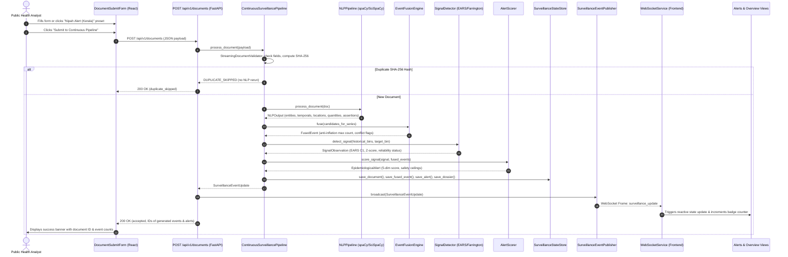

# EpiSense — Complete API Specification, WebSocket Architecture, and Data Flow Audit

**Document Purpose:** Complete technical audit and API contract reference for the EpiSense Phase 12 FastAPI backend and React frontend client.  
**Backend Port:** `http://127.0.0.1:8008`  
**WebSocket URI:** `ws://127.0.0.1:8008/api/v1/ws/surveillance`  
**Authoritative Source Directory:** `src/episense/api/`

---

## 1. REST API Endpoint Catalog

The table below catalogs every endpoint registered in `src/episense/api/routes/` and `app.py`:

| HTTP Method | Route URL | Tag | Request Model / Params | Response Model | Purpose & Function | Source File |
| :--- | :--- | :--- | :--- | :--- | :--- | :--- |
| **GET** | `/health` | Health | None | `ServiceHealthResponse` | High-level system availability, version (1.0.0), and pipeline health. | `src/episense/api/routes/health.py:19` |
| **GET** | `/health/ready` | Health | None | `ReadinessResponse` | Kubernetes readiness probe; returns current in-memory counts (`documents`, `alerts`, `events`). | `src/episense/api/routes/health.py:37` |
| **GET** | `/health/live` | Health | None | `LivenessResponse` | Kubernetes liveness probe; verifies process responsiveness (`live: True`). | `src/episense/api/routes/health.py:58` |
| **POST** | `/api/v1/documents` | Documents | `DocumentIngestionRequest` (JSON) | `DocumentIngestionResponse` | Ingests a new dispatch into the continuous pipeline, running NLP, fusion, anomaly detection, scoring, and WS fan-out. | `src/episense/api/routes/documents.py:22` |
| **GET** | `/api/v1/alerts` | Alerts | `tier`, `pathogen`, `location`, `threat_tier`, `min_score`, `max_score`, `page`, `page_size` | `PaginatedResponse[EpidemiologicalAlert]` | Paginated, filtered alert query returning composite scores, tiers, and timestamps. | `src/episense/api/routes/alerts.py:21` |
| **GET** | `/api/v1/alerts/{alert_id}` | Alerts | `alert_id: UUID` (path) | `EpidemiologicalAlert` | Detailed alert object including 5-dimension score breakdown and driving factors. | `src/episense/api/routes/alerts.py:54` |
| **GET** | `/api/v1/alerts/{alert_id}/dossier` | Provenance | `alert_id: UUID` (path) | `ExplainabilityDossier` | Full 5W1H briefing, reconstructed character-level text spans, and lineage DAG. | `src/episense/api/routes/provenance.py:21` |
| **GET** | `/api/v1/alerts/{alert_id}/audit` | Provenance | `alert_id: UUID` (path) | `AlertAuditTrail` | 8-step decision path with intermediate inputs/outputs and SHA-256 state seal. | `src/episense/api/routes/provenance.py:37` |
| **GET** | `/api/v1/alerts/{alert_id}/provenance` | Provenance | `alert_id: UUID` (path) | `ProvenanceGraph` | Standalone acyclic directed graph (DAG) tracing alert backward to raw text. | `src/episense/api/routes/provenance.py:53` |
| **GET** | `/api/v1/events` | Fused Events | `pathogen`, `location`, `assertion_status`, `source_group`, `start_date`, `end_date`, `page`, `page_size` | `PaginatedResponse[FusedEvent]` | Paginated query of canonical fused incidents with anti-inflation case counts. | `src/episense/api/routes/events.py:22` |
| **GET** | `/api/v1/events/{event_id}` | Fused Events | `event_id: UUID` (path) | `FusedEvent` | Retrieves a single canonical fused incident by its UUID. | `src/episense/api/routes/events.py:51` |
| **GET** | `/api/v1/signals` | Early Signals | `pathogen`, `location`, `signal_level`, `detection_method`, `reliability_status`, `page`, `page_size` | `PaginatedResponse[SignalObservation]` | Paginated query of EARS C1-C3 and Farrington statistical aberrations. | `src/episense/api/routes/signals.py:25` |
| **GET** | `/api/v1/signals/{signal_id}` | Early Signals | `signal_id: UUID` (path) | `SignalObservation` | Retrieves single signal observation with mathematical deviation and Z-score. | `src/episense/api/routes/signals.py:52` |
| **GET** | `/api/v1/geo/alerts` | Geospatial | `tier`, `pathogen`, `min_score` | `GeoJSONFeatureCollection` | RFC 7946 GeoJSON FeatureCollection of alert point geometries. Geometry is `null` if ungrounded. | `src/episense/api/routes/geo.py:21` |
| **GET** | `/api/v1/geo/events` | Geospatial | `pathogen`, `assertion_status` | `GeoJSONFeatureCollection` | RFC 7946 GeoJSON FeatureCollection of canonical fused incident markers. | `src/episense/api/routes/geo.py:40` |
| **GET** | `/api/v1/geo/heatmap` | Geospatial | None | `GeoJSONFeatureCollection` | Weighted point GeoJSON for Leaflet density heatmap rendering. | `src/episense/api/routes/geo.py:57` |
| **GET** | `/api/v1/geo/summary` | Geospatial | None | `GeoSummaryResponse` | Aggregated surveillance counts and top pathogens grouped by administrative state/region. | `src/episense/api/routes/geo.py:69` |
| **WS** | `/api/v1/ws/surveillance` | Streaming | Client JSON frames | Server JSON frames | Native bidirectional WebSocket feed for live incident push and topic filtering. | `src/episense/api/websocket.py:85` |

---

## 2. WebSocket Protocol & Message Flow Specification

Implemented in `src/episense/api/websocket.py` and consumed by `frontend/src/services/websocket.ts`.

### Connection Handshake
1. **Client connects:** `GET ws://127.0.0.1:8008/api/v1/ws/surveillance`
2. **Server accepts & responds with connection ACK frame:**
   ```json
   {
     "type": "connection_ack",
     "client_id": "ws_client_4a8b1c2d3e4f",
     "status": "connected",
     "timestamp": "2026-10-22T14:15:00.000000Z"
   }
   ```

### Client Subscription Filter Message
Clients can restrict event streaming to specific pathogens, minimum risk tiers, or regions:
```json
{
  "action": "subscribe",
  "filter": {
    "pathogen": "Nipah",
    "alert_tier": "medium",
    "min_score": 0.65,
    "region": "Kerala"
  }
}
```
Server acknowledges:
```json
{
  "type": "subscription_ack",
  "filter": { "pathogen": "Nipah", "alert_tier": "medium", "min_score": 0.65, "region": "Kerala" },
  "timestamp": "2026-10-22T14:15:01.000000Z"
}
```

### Real-Time Surveillance Update Frame
Broadcast to active subscribers whenever a document produces new or updated alerts:
```json
{
  "type": "surveillance_update",
  "data": {
    "update_id": "9b1c2d3e-4f5a-6b7c-8d9e-0f1a2b3c4d5e",
    "document_id": "2a3b4c5d-6e7f-8a9b-0c1d-2e3f4a5b6c7d",
    "status": "accepted",
    "fused_events_affected": ["f1d28a92-3822-5c53-a01d-cf45d5845bc4"],
    "signals_generated": ["575ede70-d1c6-5717-b157-9070d5f4764d"],
    "alerts_generated": ["76f8fdcb-537a-518d-96c9-eb3d04db939f"],
    "alert_lifecycle_states": {
      "76f8fdcb-537a-518d-96c9-eb3d04db939f": "new"
    },
    "message": "Document ingested successfully; 1 event(s) affected",
    "timestamp": "2026-10-22T14:15:02.123456Z"
  }
}
```

### Resiliency & Heartbeats
- The client sends ping frames `{"action": "ping"}` every 30 seconds.
- The server replies with `{"type": "pong"}`.
- If the WebSocket closes abruptly, the frontend exponential backoff attempts reconnection at $1\text{s}, 2\text{s}, 4\text{s}, \dots$ up to a maximum delay of $10\text{s}$.

---

## 3. Step-by-Step Data Lifecycle: From Form Submission to Dashboard Render

The diagram below traces an analyst report submitted through the dashboard:



---

## 4. Key Pydantic Schemas

### `DocumentIngestionRequest` (`src/episense/api/models.py`)
```python
class DocumentIngestionRequest(BaseModel):
    title: str = Field(..., min_length=1, max_length=500)
    source_id: str = Field(..., min_length=1, max_length=100)
    source_type: str = Field(default="official_bulletin")
    text: str = Field(..., min_length=1)
    publication_date: Optional[datetime] = None
    url: Optional[str] = None
```

### `EpidemiologicalAlert` (`src/episense/schemas/alert.py`)
```python
class EpidemiologicalAlert(BaseModel):
    alert_id: UUID
    signal_id: UUID
    disease_key: str
    geo_key: str
    pathogen_threat_tier: PathogenThreatTier
    period_start: datetime
    period_end: datetime
    composite_score: float = Field(..., ge=0.0, le=1.0)
    alert_tier: AlertTier  # INFORMATIONAL, LOW, MEDIUM, HIGH
    is_gated: bool
    gating_reason: Optional[str] = None
    score_breakdown: RiskScoreBreakdown
    explanation: AlertExplanation
    supporting_fused_event_ids: List[UUID]
    supporting_source_count: int
    provenance_references: List[ProvenanceReference]
    created_at: datetime
```

### `ExplainabilityDossier` (`src/episense/schemas/explainability.py`)
```python
class ExplainabilityDossier(BaseModel):
    dossier_id: UUID
    alert_id: UUID
    disease_key: str
    geo_key: str
    period_start: datetime
    period_end: datetime
    alert_tier: AlertTier
    composite_score: float
    pathogen_threat_tier: PathogenThreatTier
    briefing: FiveWOneHBriefing
    executive_summary: str
    driving_risk_factors: List[str]
    applied_safety_constraints: List[str]
    reconstructed_evidence: List[ReconstructedEvidenceSpan]
    lineage_graph: ProvenanceGraph
    provenance_complete: bool
    completeness_notes: Optional[str] = None
    created_at: datetime
```
