# EpiSense — System Architecture & Pipeline Execution Engine

## 1. System Overview & Topological Architecture

**EpiSense** is a research-grade, continuous epidemiological intelligence and early-warning surveillance system designed to bridge the critical temporal gap between real-world disease outbreaks and official epidemiologic bulletins.

The architecture is partitioned into four decoupled layers:
1. **Public-Health Data Acquisition & Connector Layer:** Modular adapters executing scheduled and on-demand polling against official health agency feeds (WHO RSS, PIB MoHFW, CDC Outbreaks, ProMED, IDSP) with cryptographic SHA-256 deduplication and failure isolation.
2. **17-Stage NLP & Epidemiological Inference Pipeline:** End-to-end computational linguistic pipeline transforming raw, unstructured text into verified clinical entities, temporal assertions, geographic centroids, and quantitative epidemiological incident models.
3. **Multi-Source Event Fusion & Anomaly Detection Engine:** Incident corroboration applying Decision D05 composite matching ($0.35 D + 0.30 G + 0.25 T + 0.10 A \ge 0.78$), anti-inflation quantity attribution, EARS C1–C3, and Bounded Farrington statistical baseline estimators.
4. **State Persistence, WebSocket Broadcast & Analytical Console Layer:** Durable SQLite persistence in WAL mode, subscription-filtered WebSocket event streaming (`ws://127.0.0.1:8008/api/v1/ws/surveillance`), and a React 18 / TypeScript 10-view operational research console.

```mermaid
flowchart TD
    subgraph S["External Public Health Sources"]
        WHO["WHO News RSS"]
        MOHFW["PIB MoHFW RSS"]
        CDC["CDC Outbreak Feed"]
        PROMED["ProMED-mail (Honest 404)"]
        IDSP["IDSP Portal (Auth Req)"]
    end

    subgraph C["Ingestion & Connector Layer"]
        SC["SourcePollingService"]
        VAL["StreamingDocumentValidator"]
        HASH["SHA-256 Content Deduplicator"]
    end

    subgraph P["17-Stage NLP & Inference Pipeline"]
        S01["Stage 1: Validation"]
        S02["Stage 2: Deduplication Gate"]
        S03["Stage 3: Language & Preprocessing"]
        S04["Stage 4: Sentence Segmentation"]
        S05["Stage 5: Biomedical NER"]
        S06["Stage 6: Clinical Assertion"]
        S07["Stage 7: Temporal Extraction"]
        S08["Stage 8: Geospatial Resolution"]
        S09["Stage 9: Quantity Extraction"]
        S10["Stage 10: Candidate Generation"]
        S11["Stage 11: Multi-Source Fusion"]
        S12["Stage 12: Baseline Query"]
        S13["Stage 13: Statistical Anomaly Detection"]
        S14["Stage 14: Multi-Criteria Risk Scoring"]
        S15["Stage 15: Explainability Dossier"]
        S16["Stage 16: Audit Trail Generation"]
        S17["Stage 17: State & Durable Persistence"]
    end

    subgraph D["Durable Storage & Persistence"]
        SQL["SQLite (data/surveillance_store.sqlite in WAL mode)"]
        MEM["SurveillanceStateStore (In-Memory Hot Index)"]
    end

    subgraph UI["Operational Research Console (Port 5173)"]
        DASH["Live Surveillance & Overview"]
        WORK["NLP 17-Stage Workbench"]
        FUSE["Event Fusion Inspector"]
        VALVIEW["Research & Empirical Validation"]
        CONN["Source Connectors Telemetry"]
    end

    S --> SC --> VAL --> HASH --> S01 --> S02 --> S03 --> S04 --> S05 --> S06 --> S07 --> S08 --> S09 --> S10 --> S11 --> S12 --> S13 --> S14 --> S15 --> S16 --> S17
    S17 --> SQL
    S17 --> MEM
    MEM --> UI
    SQL --> UI
```

---

## 2. The 17-Stage Continuous Surveillance Pipeline

Every document ingested into EpiSense passes deterministically through a sequential 17-stage pipeline managed by `ContinuousSurveillancePipeline` (`src/episense/streaming/pipeline.py`). Execution telemetry, stage duration, input summaries, output summaries, and isolated errors are captured in an immutable `DocumentPipelineTrace`:

| Stage # | Stage Identifier | Module / Class | Functional Responsibility |
| :--- | :--- | :--- | :--- |
| **01** | `ingestion_validation` | `StreamingDocumentValidator` | Validates schema conformance, non-empty text/title, and RFC-3339 timestamps. |
| **02** | `deduplication_gate` | `SurveillanceStateStore` | Checks SHA-256 hash against existing database to eliminate duplicate ingestion. |
| **03** | `language_preprocessing` | `ContinuousSurveillancePipeline` | Verifies language tag (en), normalizes whitespace, and extracts metadata. |
| **04** | `sentence_segmentation` | `NLPPipeline` / `spaCy` | Segments document into discrete linguistic sentences with character boundaries. |
| **05** | `biomedical_ner` | `BiomedicalEntityExtractor` | Extracts disease names, syndromic tokens, and pathogen mentions. |
| **06** | `assertion_classification`| `AssertionAnalyzer` | Classifies diagnostic status (`CONFIRMED`, `SUSPECTED`, `NEGATED`, `HISTORICAL`). |
| **07** | `temporal_extraction` | `TemporalExtractor` | Resolves event dates, reference weeks, and normalizes to ISO-8601 intervals. |
| **08** | `geospatial_resolution` | `GeospatialResolver` | Grounding toponyms to normalized GeoNames districts, states, and coordinates. |
| **09** | `quantity_extraction` | `QuantityExtractor` | Extracts case counts, deaths, hospitalizations, contacts; excludes 4-digit years. |
| **10** | `candidate_generation` | `EventCandidate` | Synthesizes discrete observation tuples (Disease, Location, Time, Quantity, Assertion). |
| **11** | `multi_source_fusion` | `EventFusionEngine` | Corroborates candidates across sources using Decision D05 formula ($S_{\text{match}} \ge 0.78$). |
| **12** | `baseline_query` | `EpidemiologicalTimeBin` | Retrieves historical incidence time-series for the disease-geography bin. |
| **13** | `anomaly_detection` | `AnomalyDetector` | Computes EARS C1–C3 and Bounded Farrington deviations against expected baseline. |
| **14** | `risk_scoring` | `AlertScorer` | Evaluates 5-factor weighted risk $[0.30, 0.25, 0.20, 0.15, 0.10]$ and assigns alert tier. |
| **15** | `explainability_dossier` | `DossierGenerator` | Builds structured clinical narratives, driving factors, and reliability gating rationale. |
| **16** | `audit_trail` | `ProvenanceAuditor` | Links extracted entities directly back to document character offsets $[start, end]$. |
| **17** | `state_persistence` | `SurveillanceDatabase` | Commits documents, traces, fused events, signals, alerts, and dossiers to SQLite WAL. |

---

## 3. Durable Storage & SQLite WAL Architecture

To ensure operational survival across backend restarts without data loss, EpiSense utilizes a production-grade SQLite persistence layer (`src/episense/persistence/database.py`):

1. **Storage Location:** `data/surveillance_store.sqlite`
2. **Journal Mode:** Write-Ahead Logging (`PRAGMA journal_mode=WAL`), allowing concurrent readers without locking writer transactions.
3. **Synchronous Mode:** `NORMAL` for high-throughput streaming commits.
4. **Foreign Key Integrity:** `PRAGMA foreign_keys=ON`.
5. **Relational Schema:**
   - `documents`: Primary document store with origin classification (`LIVE_EXTERNAL`, `HISTORICAL_CORPUS`, `BENCHMARK`).
   - `pipeline_traces`: Full JSON-serialized 17-stage telemetry and step-by-step audit records.
   - `fused_events`: Canonical clustered events with aggregated quantities and supporting candidate links.
   - `signals`: Statistical anomaly detections with z-scores, Farrington thresholds, and baseline means.
   - `alerts`: Prioritized epidemiological alerts with composite risk scores and gating flags.
   - `dossiers`: Structured explainability summaries and clinical justifications.
   - `audit_trails`: Character span grounding references.
   - `source_connectors`: Registered external feed configurations and polling states.
   - `source_poll_history`: Execution timestamps, HTTP statuses, document yields, and latencies.

---

## 4. Real-Time Surveillance WebSocket Bus

Real-time streaming surveillance updates are delivered to dashboard clients over WebSockets via `SurveillanceEventPublisher` (`src/episense/api/websocket.py`):

- **Endpoint:** `ws://127.0.0.1:8008/api/v1/ws/surveillance`
- **Session Lifecycle:** Non-blocking connection registration, unique client identifiers (`ws_client_<hex>`), heartbeat ping/pong frames.
- **Client-Side Filtering:** Clients can subscribe to specific pathogen keys, geographic regions, or minimum risk scores.
- **Synchronous Bridge:** `broadcast_sync(payload)` allows background connector worker threads to schedule immediate broadcasts into the asyncio event loop.
