# EpiSense — Complete Project Knowledge Base & Reverse Engineering Audit

**Project Title:** EpiSense — Explainable Multi-Source NLP Framework & Continuous Surveillance Platform for Early Epidemic Intelligence  
**Authoritative Workspace:** `C:\Users\ajaya\Desktop\NLP`  
**Runtime Architecture:** Python 3.11 FastAPI Backend (`http://127.0.0.1:8008`) + React 19 / TypeScript / Vite Operations Console (`http://127.0.0.1:5174`)  
**Audit & Verification Date:** October 2026  
**Document Status:** Grounded Technical Audit (No Hallucinations, Strictly Traced to Code & Data)

---

## 1. Executive Summary & Epistemic Scope

EpiSense is an open, modular, deterministic Natural Language Processing (NLP) framework and continuous surveillance platform designed for public health epidemiologists, biosecurity analysts, and district surveillance officers.

### What EpiSense Is
1. **A Context-Aware Epidemiological Text Mining Engine:** Extracts diseases, clinical syndromes, administrative toponyms, temporal intervals, and quantities from unstructured public health narratives.
2. **A Cross-Corroboration Fusion Engine:** Clusters multi-source dispatches (WHO Disease Outbreak News, IDSP state weekly reports, PIB government bulletins, ProMED mail, and medRxiv preprints) into canonical incident entities, enforcing anti-inflation invariants against media echo chambers.
3. **A Statistical Anomaly Detection Suite:** Applies CDC EARS (C1, C2, C3) and Bounded Farrington quasi-Poisson overdispersion algorithms on weekly incident time-series bins.
4. **A Multi-Criteria Risk Assessment Framework:** Scores composite public health risk across 5 bounded dimensions (Anomaly, Pathogen Threat, Evidence Corroboration, Clinical Certainty, Spatial Specificity), gated by strict reliability ceilings.
5. **A Forensic Explainability System:** Traces every alert to a 5W1H briefing, character-level raw text evidence spans ($text[start:end] == span$), an 8-step decision audit path, a provenance DAG, and a SHA-256 state seal.
6. **A Zero-Coordinate-Fabrication GIS Console:** Strictly segregates verified administrative gazetteer coordinates from unlocated entities via an Unresolved Geometry Drawer.

### What EpiSense Is NOT (Epistemic Boundaries)
* **NOT a Clinical Diagnostic Tool:** Does not triage individual patients, diagnose pathology, or substitute for physician evaluation.
* **NOT an Outbreak Confirmation Authority:** Emits statistical surveillance aberrations and risk scores; never declares an official epidemic. Official outbreak declarations remain the sole legal prerogative of health authorities (e.g., MoHFW, WHO).
* **NOT an AI Oracle / Uncontrolled LLM Wrapper:** All extraction, linking, scoring, and explainability algorithms execute deterministically on local CPU via explicit rules, verified regular expressions, spaCy pipelines, and closed-form mathematical equations. Zero nondeterministic cloud LLM APIs are used in the surveillance decision loop.

---

## 2. End-to-End System Architecture & Dependency Map

The following flowchart illustrates the unbroken dependency lineage from heterogeneous raw document ingestion to the interactive analyst dashboard:

```mermaid
flowchart TD
    subgraph Ingestion["1. Ingestion & Deduplication"]
        D1["Raw Dispatch / Bulletin\n(POST /api/v1/documents or Manifest)"] --> VAL["StreamingDocumentValidator\n(streaming/ingestion.py)"]
        VAL -->|Valid Payload| HASH["SHA-256 Content Hash Check\n(streaming/state.py)"]
        VAL -->|Malformed| DL["DeadLetterRecord\n(streaming/state.py)"]
        HASH -->|Duplicate| DUP["DUPLICATE_SKIPPED\n(Metrics updated)"]
        HASH -->|New Document| REG["Register in SurveillanceStateStore\n(110 baseline docs)"]
    end

    subgraph NLPEngine["2. Context-Aware Clinical NLP Engine"]
        REG --> LOADER["DocumentTextLoader\n(nlp/loader.py)"]
        LOADER --> SEG["SentenceSegmenter & spaCy en_core_web_sm\n(nlp/segmentation.py)"]
        SEG --> NER["HybridHealthEntityExtractor\nscispaCy en_core_sci_sm + Disease Lexicon\n(nlp/entities/extractor.py)"]
        SEG --> ASS["ContextualAssertionAnalyzer\nClause-level Negation/History/Suspicion\n(nlp/assertion/analyzer.py)"]
        SEG --> TEMP["RuleBasedTemporalExtractor\nIntervals, Explicit Dates, dateparser\n(nlp/temporal/extractor.py)"]
        SEG --> GEO["CautiousLocationResolver\nLocal SQLite Gazetteer (Admin 0-4)\n(nlp/geospatial/resolver.py)"]
        SEG --> QTY["QuantityExtractor\nRegex counts, units, adjacent context\n(nlp/quantities.py)"]
        NER & ASS & TEMP & GEO & QTY --> ASSOC["ContextAssociator & ProvenanceValidator\n(nlp/context.py & nlp/provenance.py)"]
        ASSOC --> NLPOUT["NLPOutput Schema\n(schemas/nlp.py)"]
    end

    subgraph FusionEngine["3. Multi-Source Event Fusion"]
        NLPOUT --> BUILD["EventCandidateBuilder\n(events/builder.py)"]
        BUILD --> MATCH["EventMatcher\n0.35 Dis + 0.30 Geo + 0.25 Temp + 0.10 Ass\nThreshold >= 0.78\n(fusion/matcher.py)"]
        MATCH --> AGG["QuantityAggregator\nAnti-Inflation: max(distinct) + conflict flag\n(fusion/quantities.py)"]
        MATCH --> TRK["SourceIndependenceTracker\nWire syndication vs independent agency\n(fusion/source_independence.py)"]
        AGG & TRK --> FUSED["FusedEvent Entities\n(170 baseline events)\n(fusion/engine.py)"]
    end

    subgraph AnomalyEngine["4. Time-Series & Anomaly Detection"]
        FUSED --> TS["TimeSeriesBuilder\nDeterministic ISO Weekly Bins\n(baseline/timeseries.py)"]
        TS --> BASE["BaselineEngine\nHistorical mean, median, std dev\n(baseline/engine.py)"]
        BASE --> DET["SignalDetector\n(anomaly/detector.py)"]
        DET --> EARS["EARS C1, C2 (2-wk guard), C3 (3-wk persist)\n(anomaly/ears.py)"]
        DET --> FARR["Bounded Farrington\nQuasi-Poisson overdispersion phi + Anscombe 2/3\n(anomaly/farrington.py)"]
        EARS & FARR --> GATING_SIG["Reliability Gating\nINSUFFICIENT_HISTORY / CONFLICTING_DATA\nDowngrade SIGNAL -> WATCH\n(anomaly/detector.py)"]
        GATING_SIG --> SIG["SignalObservation Records\n(170 baseline signals)\n(schemas/signal.py)"]
    end

    subgraph ScoringEngine["5. Multi-Criteria Risk Scoring & Safety Gating"]
        SIG & FUSED --> SCORER["AlertScorer\n0.30 Anomaly + 0.25 Threat + 0.20 Evidence\n+ 0.15 Certainty + 0.10 Spatial\n(scoring/scorer.py)"]
        SCORER --> CEILING["Safety Ceilings & Reliability Caps\nNegation suppression (0.0)\nConflicting quantity penalty (-0.10)\nInsufficient history cap (0.79 / 0.64)\nSingle source isolation cap (0.79)"]
        CEILING --> ALERT["EpidemiologicalAlert\n(170 baseline alerts; Tiers: INFO, LOW, MED, HIGH)\n(schemas/alert.py)"]
    end

    subgraph ExplainEngine["6. Explainability & Provenance"]
        ALERT --> DOSSIER["DossierGenerator\n5W1H Briefing & Context Citations\n(explainability/dossier.py)"]
        ALERT --> AUDIT["AuditTrailEngine\n8-Step Decision Path & SHA-256 Checksum\n(explainability/auditor.py)"]
        ALERT --> DAG["ProvenanceGraphBuilder\nAcyclic Lineage DAG (Document -> Span -> Event -> Signal -> Alert)\n(explainability/graph.py)"]
    end

    subgraph Interface["7. Delivery & Operational Console"]
        DOSSIER & AUDIT & DAG & ALERT & FUSED & SIG --> FASTAPI["FastAPI REST API Server (Port 8008)\n(api/server.py & api/routes/*)"]
        FASTAPI --> WS["SurveillanceEventPublisher\nws://127.0.0.1:8008/api/v1/ws/surveillance\n(api/websocket.py)"]
        FASTAPI & WS --> REACT["React 19 Operations Console (Port 5174)\n8 Core Views, Leaflet GIS, Obsidian Design System\n(frontend/src/*)"]
    end
```



---

## 3. Module Inventory & Inter-Module Communication

| Subsystem | Source Path | Primary Class / Function | Inputs | Outputs | Consumed By |
| :--- | :--- | :--- | :--- | :--- | :--- |
| **Ingestion Validation** | `src/episense/streaming/ingestion.py` | `StreamingDocumentValidator.validate()` | Raw dict or `Document` payload | `Tuple[bool, Optional[DeadLetterRecord], Optional[Document]]` | `ContinuousSurveillancePipeline` (`pipeline.py:103`) |
| **State Store** | `src/episense/streaming/state.py` | `SurveillanceStateStore` | Validated documents, events, signals, alerts | Thread-safe in-memory collections, indices, checkpoint JSON | Fast API dependency injection (`dependencies.py:15`) |
| **NLP Coordinator** | `src/episense/nlp/pipeline.py` | `NLPPipeline.process_document()` | `Document` or raw text | `NLPOutput` (entities, temporals, locations, quantities, assertions) | `ContinuousSurveillancePipeline` (`pipeline.py:126`) |
| **Entity Extractor** | `src/episense/nlp/entities/extractor.py` | `HybridHealthEntityExtractor.extract()` | Raw text string, `document_id` | `List[Entity]` with exact verified character spans | `NLPPipeline` (`pipeline.py:90`) |
| **Entity Taxonomy** | `src/episense/nlp/entities/taxonomy.py` | `DISEASE_LEXICON`, `SYMPTOM_LEXICON` | Surveillance disease keywords | Canonical names, ICD-10 codes (e.g. `ICD10:B27.8`) | `EntityNormalizer` (`normalizer.py:25`) |
| **Assertion Analyzer**| `src/episense/nlp/assertion/analyzer.py` | `ContextualAssertionAnalyzer.analyze()` | Raw text string, `List[Entity]` | `List[Assertion]` (`CONFIRMED`, `SUSPECTED`, `NEGATED`, `HISTORICAL`, `HYPOTHETICAL`) | `NLPPipeline` (`pipeline.py:93`), `EventMatcher` |
| **Temporal Extractor**| `src/episense/nlp/temporal/extractor.py` | `RuleBasedTemporalExtractor.extract()` | Raw text string, reference `datetime` | `List[TemporalExpression]` (`POINT`, `INTERVAL`, `YEAR`) | `NLPPipeline` (`pipeline.py:96`), `EventMatcher` |
| **Location Resolver**| `src/episense/nlp/geospatial/resolver.py` | `CautiousLocationResolver.resolve_mentions()`| Raw text string | `List[ResolvedLocation]` (`RESOLVED`, `AMBIGUOUS`, `UNRESOLVED`) | `NLPPipeline` (`pipeline.py:99`), `GeoResolver` |
| **Gazetteer DB** | `src/episense/nlp/geospatial/gazetteer.py` | `LocalGazetteer.lookup()` | Toponym string | `List[Location]` (Admin 0–4 with verified GeoNames ID and Lat/Lon) | `CautiousLocationResolver` (`resolver.py:79`) |
| **Quantity Extractor**| `src/episense/nlp/quantities.py` | `QuantityExtractor.extract()` | Raw text string | `List[QuantityMention]` (cases, deaths, contacts) | `NLPPipeline` (`pipeline.py:102`), `EventCandidateBuilder` |
| **Candidate Builder** | `src/episense/events/builder.py` | `EventCandidateBuilder.build_candidates()` | `NLPOutput`, `source_id`, pub time | `List[EventCandidate]` | `ContinuousSurveillancePipeline` (`pipeline.py:144`) |
| **Event Matcher** | `src/episense/fusion/matcher.py` | `EventMatcher.match()` | Pair of `EventCandidate` objects | `MatchEvaluation` (`decision`, `score`, `rationale`) | `EventFusionEngine` (`engine.py:73`) |
| **Quantity Aggregator**| `src/episense/fusion/quantities.py`| `QuantityAggregator.aggregate()` | `List[EventObservation]` | `EpidemiologicalQuantities` (`max` count, conflict flag) | `EventFusionEngine` (`engine.py:133`) |
| **Fusion Engine** | `src/episense/fusion/engine.py` | `EventFusionEngine.fuse()` | `List[EventCandidate]` for a series | `List[FusedEvent]` (170 baseline events) | `ContinuousSurveillancePipeline` (`pipeline.py:189`) |
| **Time Series Builder**| `src/episense/baseline/timeseries.py` | `TimeSeriesBuilder.build_weekly_bins()` | `List[FusedEvent]` for a series | `List[EpidemiologicalTimeBin]` (ISO Year/Week) | `ContinuousSurveillancePipeline` (`pipeline.py:208`) |
| **Baseline Estimator**| `src/episense/baseline/engine.py` | `BaselineEngine.compute_baseline()` | Historical bins, target bin | `BaselineEstimate` (mean, median, std, reliability) | `SignalDetector` (`detector.py:47`) |
| **EARS Detector** | `src/episense/anomaly/ears.py` | `EARSDetector.evaluate_c1/c2/c3()` | Count sequence, target index | `EARSResult` (statistic, threshold, alert boolean) | `SignalDetector` (`detector.py:95-97`) |
| **Farrington Detector**| `src/episense/anomaly/farrington.py`| `BoundedFarringtonDetector.evaluate()` | Historical reference counts, observed | `FarringtonResult` ($\mu$, $\phi$, threshold, alert) | `SignalDetector` (`detector.py:101`) |
| **Signal Detector** | `src/episense/anomaly/detector.py` | `SignalDetector.detect_signal()` | Historical bins, target bin, baseline | `SignalObservation` (`WATCH`, `SIGNAL`, `STRONG_SIGNAL`) | `AlertScorer` (`scorer.py:92`) |
| **Threat Classifier** | `src/episense/scoring/threat.py` | `PathogenThreatClassifier.classify()` | Canonical disease key string | `PathogenThreatTier` (Tier 1–4, Score 0.25–1.00) | `AlertScorer` (`scorer.py:136`) |
| **Alert Scorer** | `src/episense/scoring/scorer.py` | `AlertScorer.score_signal()` | `SignalObservation`, `FusedEvent` list | `EpidemiologicalAlert` (Score, Tier, Gating) | `DossierGenerator`, `AuditTrailEngine` |
| **Audit Engine** | `src/episense/explainability/auditor.py` | `AuditTrailEngine.build_audit_trail()` | Alert, Signal, Baseline | `AlertAuditTrail` (8 decision steps, SHA-256 seal) | `ContinuousSurveillancePipeline` (`pipeline.py:284`) |
| **Dossier Generator** | `src/episense/explainability/dossier.py` | `DossierGenerator.create_dossier()` | Alert, Signal, Events, Documents | `ExplainabilityDossier` (5W1H briefing, spans, DAG) | API route `/alerts/{id}/dossier` |
| **API Server** | `src/episense/api/server.py` | `create_surveillance_server()` | Preload boolean | Configured FastAPI application instance | Uvicorn runner (`run_server.py:18`) |
| **WebSocket Broker** | `src/episense/api/websocket.py` | `SurveillanceEventPublisher.broadcast()` | `SurveillanceEventUpdate`, alert lookup | Async fan-out JSON frames to connected WS clients | Native WebSocket client in frontend (`websocket.ts`) |

---

## 4. Problem Statement & Epidemiological Foundations

### The Problem in Public Health Surveillance
Public health intelligence relies heavily on open-source epidemic intelligence (OSINT). Outbreaks are frequently reported in local news dispatches, regional press bulletins, and official notices days or weeks before centralized laboratory confirmation registers in international databases. However, automated processing of open-source text faces critical challenges:
1. **Keyword Mentions vs. Active Outbreaks:** A simple keyword search for *"Nipah"* triggers identically on *"Two cases of Nipah virus confirmed in Kozhikode"*, *"Zero cases of Nipah were reported"*, *"Nipah virus preparedness guidelines issued"*, and *"A retrospective review of the 2018 Nipah outbreak"*. Traditional systems suffer massive false positive rates because they confuse linguistic mention with epidemiological reality.
2. **Media Velocity vs. Case Inflation:** When a high-consequence pathogen emerges, hundreds of news syndicates republish the same wire report. Blindly summing case counts reported across news articles turns a single cluster of 2 cases into hundreds of nonexistent infections.
3. **Sparse and Overdispersed Time-Series:** Outbreak occurrences in individual administrative districts are rare and zero-inflated. Standard Gaussian anomaly detection ($Z$-score) collapses when historical variance is zero ($\sigma = 0$).
4. **Coordinate Fabrication in Spatial Intelligence:** General LLMs and naive geocoders regularly hallucinate coordinates (e.g., placing rural hamlets in unrelated countries or oceanic defaults), misleading disaster response teams.

### Five Hierarchical Distinctions in EpiSense
EpiSense rigorously segregates concepts into five epistemic tiers:
1. **Clinical Entity Mention:** A character span in text naming a pathogen or symptom (e.g., *"Nipah virus"* at characters 68–89 in doc `964a043d...`).
2. **Event Candidate / Observation:** An entity associated with an epistemic assertion (`CONFIRMED`), a temporal anchor (`September 2023`), and an administrative locus (`Kozhikode`).
3. **Canonical Fused Event:** A deduplicated, cross-corroborated cluster representing a single real-world outbreak occurrence, tracking independent reporting agencies and retaining conservative quantity estimates.
4. **Statistical Early Signal:** A mathematical deviation in a weekly time bin exceeding EARS or Farrington baselines, categorized as `WATCH`, `SIGNAL`, or `STRONG_SIGNAL`.
5. **Epidemiological Alert:** A prioritized operational intelligence product scoring composite multi-criteria risk ($[0.0, 1.0]$) across five dimensions, enforced with reliability safety ceilings and sealed with an unbroken audit trail.

---

## 5. Traceable End-to-End Execution Walkthrough

The following audit trace tracks the Authoritative Benchmark Outbreak Document `964a043d-8f1f-5eb6-b91b-34e6ad194645` from raw ingestion to the analyst's dashboard modal:

```text
Step 1: Ingestion & Deduplication
  - Source: WHO Disease Outbreak News (who_don)
  - Publication Date: 2023-09-17T15:00:00Z
  - Title: "Infectious disease outbreak report: Nipah virus infection in Kerala, India"
  - SHA-256 Checksum: c098a5840dcf99965eb2b972c6bc2bfaf11438a2e2d96ee3bf0a82b99fc0d172
  - Action: Accepted by StreamingDocumentValidator; registered in SurveillanceStateStore.

Step 2: Context-Aware Clinical NLP
  - Raw Text excerpt:
    "Between 12 and 15 September 2023, six laboratory-confirmed cases of Nipah virus infection,
     including two deaths, were reported in Kozhikode district, Kerala."
  - Disease NER:
    text[68:89] = "Nipah virus infection" -> Canonical: "Nipah virus disease", ICD-10: "ICD10:B27.8", Conf: 0.95
  - Toponym Grounding:
    text[130:139] = "Kozhikode" -> LocalGazetteer: "GeoNames:1265873", Lat: 11.2588, Lon: 75.7804 (Admin 2)
  - Temporal Extraction:
    text[0:32] = "Between 12 and 15 September 2023" -> Interval: 2023-09-12 to 2023-09-15
  - Epistemic Assertion:
    Syntactic clause contains "laboratory-confirmed" -> Status: CONFIRMED, Certainty: DEFINITE
  - Quantity Extraction:
    text[34:37] = "six" -> 6 cases; text[107:110] = "two" -> 2 deaths; text[28:32] = "2023" -> extracted as number

Step 3: Cross-Corroboration Event Fusion
  - Candidate paired with ProMED report bcbdadd4-805a-50f7-8733-f4e3dc80940f ("Two individuals... Nipah virus... Kozhikode")
  - Compatibility Scores:
    Disease: 1.00; Geography: 1.00; Temporal: 1.00; Assertion: 1.00
    Composite Match Score: 0.35(1.0) + 0.30(1.0) + 0.25(1.0) + 0.10(1.0) = 1.000 >= 0.78 -> MATCH!
  - Canonical Fused Event Created: f1d28a92-3822-5c53-a01d-cf45d5845bc4
  - Quantity Aggregation & Conflict Protection:
    Distinct reported cases: [2.0, 2023.0]
    Anti-inflation invariant: Does NOT sum to 2025! Takes max(2023.0) and sets has_conflicts = True!
    Independent Source Groups: 2 ("agency:who", "syndication:promed")

Step 4: Weekly Time-Series Binning & Anomaly Detection
  - Series: ("nipah virus disease", "kozhikode")
  - Target Bin: ISO Week 2023-W37 (2023-09-11 to 2023-09-17)
  - Historical Baselines: mu = 1.00, std = 0.00 (Insufficient history / 0-variance)
  - Standardized Z-Score: Dev = +2022.00, Z = +2022.00
  - Detectors: EARS C1 triggered
  - Reliability Gating: Insufficient baseline history + conflicting quantities -> Downgraded from SIGNAL to WATCH!
  - Deterministic Signal ID: 575ede70-d1c6-5717-b157-9070d5f4764d

Step 5: Multi-Criteria Risk Scoring & Safety Gating
  - Dimension 1 (Anomaly): WATCH bounded score = 0.600 (w = 0.30)
  - Dimension 2 (Threat): Nipah Tier 4 High Consequence = 1.000 (w = 0.25)
  - Dimension 3 (Evidence): 2 independent sources (0.70) + WHO official bonus (+0.15) = 0.850 (w = 0.20)
  - Dimension 4 (Certainty): CONFIRMED assertion = 1.000 (w = 0.15)
  - Dimension 5 (Spatial): District-level Kozhikode Admin 2 = 1.000 (w = 0.10)
  - Raw Weighted Composite:
    (0.30 * 0.60) + (0.25 * 1.00) + (0.20 * 0.85) + (0.15 * 1.00) + (0.10 * 1.00)
    = 0.180 + 0.250 + 0.170 + 0.150 + 0.100 = 0.850
  - Safety Gating Applied:
    Conflicting quantity reports detected ([2, 2023]): -0.10 penalty applied!
    Final Score: 0.850 - 0.100 = 0.750
  - Operational Tier Assigned: MEDIUM (0.65 <= 0.750 < 0.80)
  - Deterministic Alert ID: 76f8fdcb-537a-518d-96c9-eb3d04db939f

Step 6: Forensic Explainability Dossier & Audit Seal
  - 5W1H Briefing: Who=Nipah, What=2023 cases/1 fused event, When=2023-09-11..17, Where=Kozhikode, Why=EARS_C1, How=2 sources
  - Reconstructed Spans: 7 exact character spans verified against raw document text.
  - Decision Audit Trail: 8 sequential steps sealed with SHA-256 hash cf6ce2e846ee48a09437e3507c071160601abbee09f4ef9ab4e49555d7d3bde9.
  - Lineage DAG: Acyclic graph linking document -> spans -> fused event -> signal -> alert.

Step 7: Dashboard Presentation
  - Rendered in Alerts Ledger (Row 1), Alert Detail Modal, Surveillance Map (Kozhikode marker), and Overview KPIs.
```

---

## 6. Software Correctness vs. Epidemiological Validation

A critical distinction must be maintained for any academic defense or technical viva:
* **Software Correctness:** Verified by **224 passing backend pytest tests** and **19 frontend vitest tests**. The code executes without errors, schemas validate, character offsets align, deduplication prevents duplicate ingestion, and REST/WebSocket endpoints respond with expected data contracts.
* **Epidemiological Validation:** Not achieved. The repository contains empirical evaluations against an 18-document gold set (F1 32.3% on exact entity spans), but **does not contain clinical field validation or real-world outbreak detection utility trials**. Anomaly detection outputs reflect statistical linguistic surges, not laboratory-validated epidemiology.

---

## 7. Authoritative Implementation Source-of-Truth Table

| Topic / Feature | Implemented Status | Primary Source File & Function | Evidence & Verification | Confidence Level |
| :--- | :--- | :--- | :--- | :--- |
| **Ingestion Idempotency** | Implemented | `src/episense/streaming/pipeline.py:116` | SHA-256 hash check; returns `duplicate_skipped` | `VERIFIED IN CODE` & `VERIFIED BY TEST` |
| **Biomedical NER** | Implemented | `src/episense/nlp/entities/extractor.py:44-51` | Hybrid scispaCy + exact lexicon matching | `VERIFIED IN CODE` & `VERIFIED BY TEST` |
| **Exact Character Spans** | Implemented | `src/episense/nlp/entities/extractor.py:60` | Invariant assertion `text[start:end] == span` | `VERIFIED IN CODE` & `VERIFIED BY TEST` |
| **ICD-10 Normalization** | Implemented | `src/episense/nlp/entities/normalizer.py:18` | Dictionary lookup in `DISEASE_LEXICON` | `VERIFIED IN CODE` |
| **Epistemic Assertion** | Implemented | `src/episense/nlp/assertion/analyzer.py:101-148`| Syntactic precedence: Negation > History > Suspected > Confirmed | `VERIFIED IN CODE` & `VERIFIED BY TEST` |
| **Temporal Parsing** | Implemented | `src/episense/nlp/temporal/extractor.py:71-99` | Regex intervals + `dateparser` | `VERIFIED IN CODE` & `VERIFIED BY TEST` |
| **Geographic Grounding** | Implemented | `src/episense/nlp/geospatial/resolver.py:79-105` | SQLite gazetteer lookup; returns `UNRESOLVED` without coordinates | `VERIFIED IN CODE` & `VERIFIED BY TEST` |
| **Zero Coord Fabrication**| Implemented | `src/episense/api/services.py:270` | Unlocated features kept as geometry `null` | `VERIFIED IN CODE` & `OBSERVED IN SCREENSHOT` |
| **Anti-Inflation Case Merging** | Implemented | `src/episense/fusion/quantities.py:53-92` | Takes `max` across reports; flags conflict; never sums | `VERIFIED IN CODE` & `VERIFIED BY TEST` |
| **Event Matcher Weights** | Implemented | `src/episense/fusion/matcher.py:104` | $0.35 D + 0.30 G + 0.25 T + 0.10 A \ge 0.78$ | `VERIFIED IN CODE` & `VERIFIED BY TEST` |
| **EARS C1 Detector** | Implemented | `src/episense/anomaly/ears.py:53` | $(Y_t - \bar{Y}) / \max(s, 1.0)$ on 7 historical periods | `VERIFIED IN CODE` & `VERIFIED BY TEST` |
| **EARS C2 Detector** | Implemented | `src/episense/anomaly/ears.py:108` | 2-week guard band $(t-9 \dots t-2)$ | `VERIFIED IN CODE` & `VERIFIED BY TEST` |
| **EARS C3 Detector** | Implemented | `src/episense/anomaly/ears.py:170` | 3-week cumulative excess $\sum \max(0, C_2 - 1.0)$ | `VERIFIED IN CODE` & `VERIFIED BY TEST` |
| **Bounded Farrington** | Implemented | `src/episense/anomaly/farrington.py:97-111` | Quasi-Poisson $\phi$ + Anscombe $(2/3)$ power transform | `VERIFIED IN CODE` & `VERIFIED BY TEST` |
| **Signal Downgrade Gating**| Implemented | `src/episense/anomaly/detector.py:147-160` | Downgrades `SIGNAL` to `WATCH` if history < 3 or conflicts | `VERIFIED IN CODE` & `VERIFIED BY TEST` |
| **Composite Alert Scoring**| Implemented | `src/episense/scoring/scorer.py:233-240` | $0.30 S_a + 0.25 S_t + 0.20 S_e + 0.15 S_c + 0.10 S_s$ | `VERIFIED IN CODE` & `VERIFIED BY TEST` |
| **Modal Weight Label Conflict** | Discrepancy | `frontend/src/components/alerts/AlertDetailModal.tsx:224` | Hardcoded labels say `w=0.35` (anomaly), backend uses `0.30` | `VERIFIED IN CODE` & `OBSERVED IN SCREENSHOT` |
| **5W1H Dossier & DAG** | Implemented | `src/episense/explainability/dossier.py:40` | Structured briefing, character spans, acyclic DAG | `VERIFIED IN CODE` & `VERIFIED BY TEST` |
| **8-Step Cryptographic Audit** | Implemented | `src/episense/explainability/auditor.py:35` | 8 sequential decision records + SHA-256 seal | `VERIFIED IN CODE` & `VERIFIED BY TEST` |
| **WebSocket Streaming Push** | Implemented | `src/episense/api/websocket.py:85` | Native WebSocket fan-out with subscription filter | `VERIFIED IN CODE` & `VERIFIED BY TEST` |
