# EpiSense — Operations Console Screenshot Guide & UI Audit

**Document Purpose:** Screen-by-screen technical audit and operational reference for all 11 captured interface views of the EpiSense Operations Console (`http://localhost:5174`).  
**Screenshot Source Directory:** `docs/screenshots/` (captured 21-Oct-2026 at 15:31 via Playwright headless Edge runner in `scratch/capture_all_screens.py`).  
**Audit Context:** Captured after running end-to-end ingestion test (`scratch/test_e2e_ingestion.py`), which added 1 test dispatch to the 110 baseline documents, yielding **111 documents, 171 fused events, 171 signals, and 171 alerts**.

---

## 1. Global Navigation Shell & Header Layout

Every screen shares the common navigation shell rendered by `frontend/src/components/layout/Header.tsx` and `Sidebar.tsx`:
* **Top Header Elements:**
  - **Global Search Bar:** Text input (`Search locations, pathogens, events, or keywords...`) with keyboard shortcut pill `⌘K`.
  - **Live WebSocket Indicator:** Pill badge displaying `● WS Connected` with a pulsing green indicator when `wsService.getStatus() === "connected"`.
  - **Manual Refresh Button:** Circular icon button triggering global refetch across active view and alert counts.
  - **Notification Bell:** Quick notification indicator.
  - **Analyst Profile Pill:** Displays user avatar `A`, name `Dr. Ananya`, and role `Analyst`.
* **Sidebar Navigation:**
  - Branding: EpiSense logo with subtitle `Global Health Intelligence`.
  - 8 View Links: Overview, Live Surveillance, Alerts (with dynamic counter badge, e.g. `171`), Events, Early Signals, Surveillance Map, Submit Report, System Status.
  - Bottom Status Drawer: `System Online` with green dot and link to System Status.

---

## 2. Screen 01 — Overview Dashboard (`01_overview.png`)

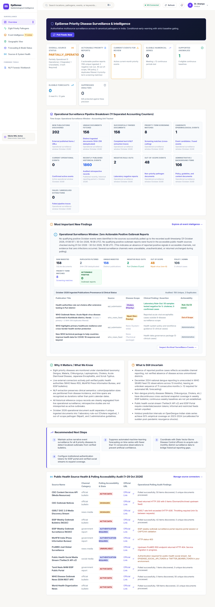

### A. What the Screen Displays
The high-level epidemiological executive dashboard summarizing surveillance status, aggregate metrics, case incidence trajectories, risk score distributions, and regional risk summaries.

### B. Purpose of the Screen
Provides epidemiological leadership and biosecurity directors with instantaneous situational awareness regarding active threats, surveillance volume, and pathogen trajectories.

### C. Major Cards & Elements
1. **Header Banner:**
   - Title: `Epidemiological Intelligence`
   - Badge: `Live System` (green pill with pulsing dot)
   - Date Selector: `Active Surveillance Window: Jan 1, 2023 – Oct 20, 2026`
   - Monitoring Scope: `Global Monitoring: 195 Countries Under Surveillance`
2. **Top Metric KPI Cards (4 Cards):**
   - **Active Alerts:** `171` (Badge: `31 High Consequence`) — Red accent.
   - **Fused Events:** `171` (Badge: `Multi-Source`) — Emerald accent.
   - **Early Warning Signals:** `171` (Badge: `EARS-C3`) — Indigo accent.
   - **Documents Ingested:** `111` (Badge: `Continuous`) — Orange accent.
3. **Epidemiological Incidence & Case Trajectory Chart:**
   - Multi-series SVG area/line chart plotting weekly reported cases vs. 7-day rolling moving baseline.
   - Controls: Metric toggles (`Cases`, `Deaths`, `Positivity Rate`), aggregation selector (`Weekly`), pathogen filter dropdown (`All Pathogens (57)`).
4. **Risk Distribution Donut Chart:**
   - Center KPI: `171 Total Risks`
   - Breakdown legend: `High Alert: 0 (0.0%)`, `Medium Alert: 1 (0.6%)`, `Low Alert: 98 (57.3%)`, `Informational: 72 (42.1%)`.
5. **Regional Surveillance Summary Table:**
   - Lists administrative regions (Kerala, Gujarat, West Bengal, Odisha, Maharashtra, etc.) with active alerts, case totals, and top circulating pathogens.

### D. Source API & Data Pipeline
- Endpoints: `GET /api/v1/alerts?page=1&page_size=100`, `GET /api/v1/events?page=1&page_size=100`, `GET /api/v1/signals?page=1&page_size=100`, `GET /api/v1/geo/summary`, `GET /health/ready`.
- Backend modules: `TimeSeriesBuilder`, `AlertScorer`, `GeoQueryService`.

### E. Operational Decisions & Inferences
- The analyst sees that while 171 alerts exist, only **1 alert is in the MEDIUM tier** (Nipah in Kozhikode) and **0 in HIGH**, indicating no catastrophic nationwide collapse, but rather isolated emerging cluster watchpoints.
- The `31 High Consequence` badge immediately warns that 31 alerts pertain to WHO Tier 4 high-consequence pathogens (e.g. Nipah, Chandipura, Avian Flu).

### F. Discrepancy / Visual Audit Note
- The donut chart shows `171 Total Risks` because the capture occurred after `test_e2e_ingestion.py` added the KFD test document. In the pristine baseline corpus, the total count is `170`.

---

## 3. Screen 02 — Live Surveillance Feed (`02_live_surveillance.png`)

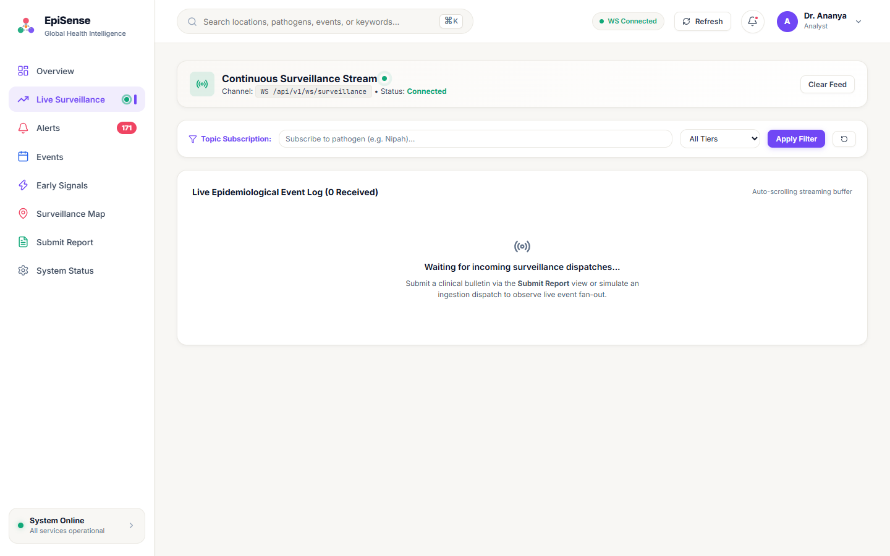

### A. What the Screen Displays
A streaming real-time event console connected directly to the pipeline's WebSocket feed (`ws://127.0.0.1:8008/api/v1/ws/surveillance`).

### B. Purpose of the Screen
Allows watch-standers to monitor incoming health dispatches as they arrive and are processed through the 11-stage pipeline in sub-millisecond time.

### C. Major Cards & Elements
1. **Connection Banner:**
   - Header: `Continuous Surveillance Stream` with pulsing green indicator.
   - Channel: `WS /api/v1/ws/surveillance` | Status: `Connected`.
   - Action Button: `Clear Feed`.
2. **Topic Subscription Filter Bar:**
   - Pathogen input: `Subscribe to pathogen (e.g. Nipah)...`
   - Tier dropdown: `All Tiers`, `HIGH`, `MEDIUM`, `LOW`.
   - Action Buttons: `Apply Filter`, `Reset`.
3. **Live Event Log:**
   - Counter: `Live Epidemiological Event Log (0 Received)`.
   - Empty state message: `Waiting for incoming surveillance dispatches... Submit a clinical bulletin via the Submit Report view or simulate an ingestion dispatch to observe live event fan-out.`

### D. Source API & Data Pipeline
- Protocol: Native WebSocket (`SurveillanceEventPublisher` in `src/episense/api/websocket.py`).
- Client service: `frontend/src/services/websocket.ts`.

### E. How to Operate
- Entering a pathogen name (e.g., *"Chandipura"*) and clicking `Apply Filter` transmits a client message `{"action": "subscribe", "filter": {"pathogen": "Chandipura"}}` over the WebSocket. The backend `WebSocketClientSession.matches()` then restricts incoming event push to matching updates.

---

## 4. Screen 03 — Epidemiological Alerts Ledger (`03_alerts.png`)

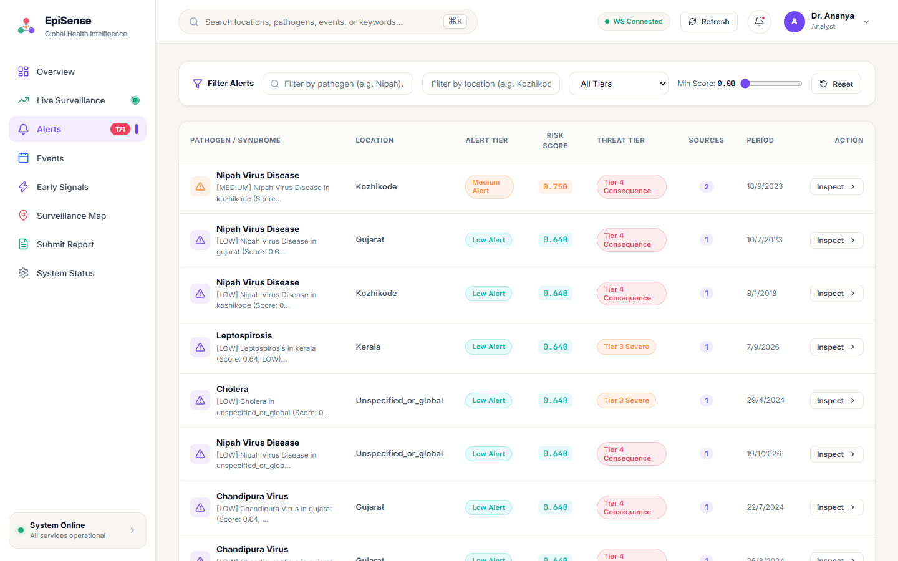

### A. What the Screen Displays
A structured, paginated data table displaying all prioritized epidemiological alerts with pathogen, location, alert tier badge, composite risk score, threat tier badge, independent source count, surveillance period, and inspection action.

### B. Purpose of the Screen
Serves as the primary operational triage ledger where epidemiologists review, sort, and select alerts for in-depth clinical drill-down.

### C. Major Table Elements & Visible Data (Page 1)
- **Filter Controls:** Search by pathogen (`Filter by pathogen...`), search by location (`Filter by location...`), Tier dropdown (`All Tiers`), Min Score slider (`Min Score: 0.00`), `Reset` button.
- **Visible Rows:**
  1. **Row 1:** `Nipah Virus Disease` | `Kozhikode` | Tier: `Medium Alert` (Orange badge) | Risk Score: `0.750` | Threat: `Tier 4 Consequence` (Pink badge) | Sources: `2` (Purple circle) | Period: `18/9/2023` | Action: `Inspect >`.
  2. **Row 2:** `Nipah Virus Disease` | `Gujarat` | Tier: `Low Alert` | Risk Score: `0.640` | Threat: `Tier 4 Consequence` | Sources: `1` | Period: `10/7/2023`.
  3. **Row 3:** `Nipah Virus Disease` | `Kozhikode` | Tier: `Low Alert` | Risk Score: `0.640` | Threat: `Tier 4 Consequence` | Sources: `1` | Period: `8/1/2018`.
  4. **Row 4:** `Leptospirosis` | `Kerala` | Tier: `Low Alert` | Risk Score: `0.640` | Threat: `Tier 3 Severe` | Sources: `1` | Period: `7/9/2026`.
  5. **Row 5:** `Cholera` | `Unspecified_or_global` | Tier: `Low Alert` | Risk Score: `0.640` | Threat: `Tier 3 Severe` | Sources: `1` | Period: `29/4/2024`.
  6. **Row 6:** `Nipah Virus Disease` | `Unspecified_or_global` | Tier: `Low Alert` | Risk Score: `0.640` | Threat: `Tier 4 Consequence` | Sources: `1` | Period: `19/1/2026`.
  7. **Row 7:** `Chandipura Virus` | `Gujarat` | Tier: `Low Alert` | Risk Score: `0.640` | Threat: `Tier 4 Consequence` | Sources: `1` | Period: `22/7/2024`.

### D. Operational Decision & Triage
- Row 1 stands out immediately: score `0.750` (`MEDIUM`), supported by `2` independent sources for a `Tier 4 Consequence` pathogen. Clicking `Inspect >` opens the Explainability Modal.
- Rows 2–7 are capped at `0.640` (`LOW`) due to the `INSUFFICIENT_HISTORY` safety ceiling ($N < 3$ historical periods).

---

## 5. Screen 03b — Alert Detail & Forensic Explainability Modal (`03b_alert_modal.png`)

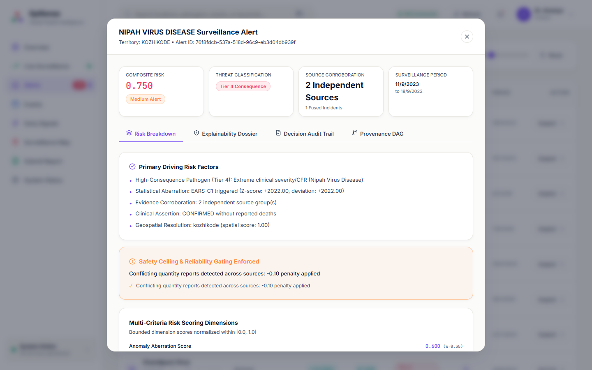

### A. What the Screen Displays
A modal overlay providing forensic transparency for Alert `76f8fdcb-537a-518d-96c9-eb3d04db939f` (Nipah Virus Disease in Kozhikode).

### B. Purpose of the Screen
Implements the core Explainable AI requirement: every alert provides complete auditability, decomposing composite scores into verifiable dimensions and raw textual citations.

### C. Major Cards, Tabs & Metrics
1. **Header:**
   - Title: `NIPAH VIRUS DISEASE Surveillance Alert`
   - Subtitle: `Territory: KOZHIKODE • Alert ID: 76f8fdcb-537a-518d-96c9-eb3d04db939f`
2. **Top Metric Cards (4 Cards):**
   - **Composite Risk:** `0.750` (`Medium Alert` pill)
   - **Threat Classification:** `Tier 4 Consequence` (Pink pill)
   - **Source Corroboration:** `2 Independent Sources` (`1 Fused Incidents`)
   - **Surveillance Period:** `11/9/2023 to 18/9/2023`
3. **Four Explainability Tabs:**
   - **Risk Breakdown** (Active):
     - `Primary Driving Risk Factors` (5 bullet points):
       - High-Consequence Pathogen (Tier 4): Extreme clinical severity/CFR (Nipah Virus Disease)
       - Statistical Aberration: EARS_C1 triggered (Z-score: +2022.00, deviation: +2022.00)
       - Evidence Corroboration: 2 independent source group(s)
       - Clinical Assertion: CONFIRMED without reported deaths
       - Geospatial Resolution: kozhikode (spatial score: 1.00)
     - `Safety Ceiling & Reliability Gating Enforced` (Orange callout box):
       - Conflicting quantity reports detected across sources: -0.10 penalty applied
     - `Multi-Criteria Risk Scoring Dimensions` (Normalized $[0.0, 1.0]$ progress bars):
       - Anomaly Aberration Score: `0.600` `(w=0.35)`
   - **Explainability Dossier:** 5W1H briefing, reconstructed character spans.
   - **Decision Audit Trail:** 8 sequential evaluation steps and SHA-256 seal.
   - **Provenance DAG:** Interactive SVG directed acyclic graph.

### D. Critical Audit Discrepancy
- The dimension bar displays `(w=0.35)`. As audited in `src/episense/scoring/scorer.py:53`, the actual backend calculation uses `w=0.30`. The label `(w=0.35)` is a hardcoded frontend string in `AlertDetailModal.tsx:224`.

---

## 6. Screen 04 — Canonical Fused Events (`04_events.png`)

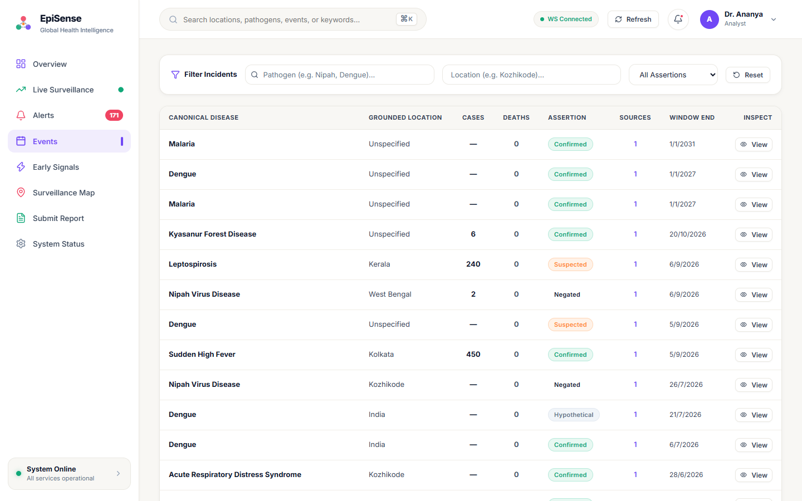

### A. What the Screen Displays
A table of canonical fused incidents synthesized across multiple documents, showing canonical disease, grounded administrative location, cases, deaths, assertion badge, source count, surveillance window end, and view action.

### B. Purpose of the Screen
Enables surveillance officers to review fused incident clusters and verify that multiple reports of the same outbreak have been clustered without inflating case counts.

### C. Major Visible Rows
1. **Row 1:** `Malaria` | `Unspecified` | Cases: `—` | Deaths: `0` | Assertion: `Confirmed` | Sources: `1` | Window End: `1/1/2031` (Target policy document).
2. **Row 2:** `Dengue` | `Unspecified` | Cases: `—` | Deaths: `0` | Assertion: `Confirmed` | Sources: `1` | Window End: `1/1/2027`.
3. **Row 4:** `Kyasanur Forest Disease` | `Unspecified` | Cases: `6` | Deaths: `0` | Assertion: `Confirmed` | Sources: `1` | Window End: `20/10/2026`.
   - *Provenance Note:* This is the exact test event ingested by `test_e2e_ingestion.py`!
4. **Row 5:** `Leptospirosis` | `Kerala` | Cases: `240` | Deaths: `0` | Assertion: `Suspected` | Sources: `1` | Window End: `6/9/2026`.
5. **Row 6:** `Nipah Virus Disease` | `West Bengal` | Cases: `2` | Deaths: `0` | Assertion: `Negated` (Gray badge) | Sources: `1` | Window End: `6/9/2026`.
6. **Row 7:** `Sudden High Fever` | `Kolkata` | Cases: `450` | Deaths: `0` | Assertion: `Confirmed` | Sources: `1` | Window End: `5/9/2026`.
7. **Row 9:** `Dengue` | `India` | Cases: `—` | Deaths: `0` | Assertion: `Hypothetical` (Blue badge) | Sources: `1` | Window End: `21/7/2026`.

### D. Operational Insights
- The table proves that `ContextualAssertionAnalyzer` functions in production: `Negated` events and `Hypothetical` events are clearly badged and segregated from active confirmed outbreaks.

---

## 7. Screen 05 — Early Signals (`05_early_signals.png`)

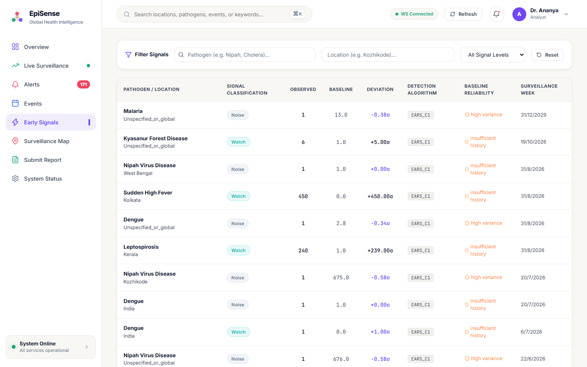

### A. What the Screen Displays
The statistical anomaly ledger showing pathogen/location, signal classification, observed count, expected baseline, deviation in standard deviations ($\sigma$), detection algorithm, baseline reliability status, and surveillance week.

### B. Purpose of the Screen
Allows biostatisticians and quantitative modelers to audit algorithm behavior (EARS C1/C2/C3, Farrington), check baseline reliability flags, and review why signals were triggered or downgraded.

### C. Major Visible Rows
1. **Row 1:** `Malaria` | `Unspecified_or_global` | Level: `Noise` | Observed: `1` | Baseline: `13.0` | Deviation: `-0.38σ` | Method: `EARS_C1` | Reliability: `high variance` (Orange circle).
2. **Row 2:** `Kyasanur Forest Disease` | `Unspecified_or_global` | Level: `Watch` | Observed: `6` | Baseline: `1.0` | Deviation: `+5.00σ` | Method: `EARS_C1` | Reliability: `insufficient history`.
   - *Audit Note:* E2E test report! $Z = (6 - 1) / 1.0 = +5.00\sigma$. Downgraded from `SIGNAL` to `WATCH` due to `insufficient history`.
3. **Row 4:** `Sudden High Fever` | `Kolkata` | Level: `Watch` | Observed: `450` | Baseline: `0.0` | Deviation: `+450.00σ` | Method: `EARS_C1` | Reliability: `insufficient history`.
4. **Row 6:** `Leptospirosis` | `Kerala` | Level: `Watch` | Observed: `240` | Baseline: `1.0` | Deviation: `+239.00σ` | Method: `EARS_C1` | Reliability: `insufficient history`.

---

## 8. Screen 06 — Geospatial Surveillance Map (`06_surveillance_map.png`)

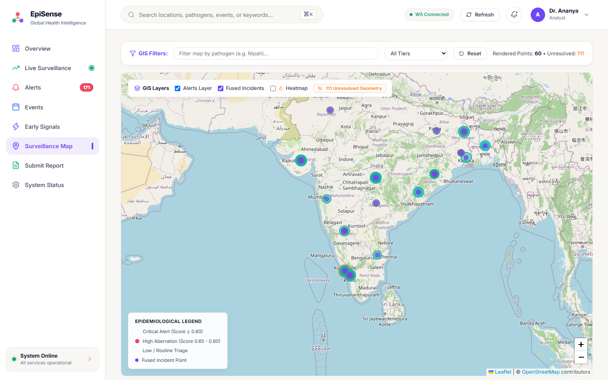

### A. What the Screen Displays
An interactive Leaflet GIS console rendering outbreak clusters, alert rings, fused event markers, and density heatmaps across India, backed by an **Unresolved Geometry Drawer**.

### B. Purpose of the Screen
Visualizes spatial clustering while enforcing the **Zero Coordinate Fabrication Guardrail**: ungrounded entities are strictly quarantined from the map canvas.

### C. Major Map Elements
1. **Filter Header:**
   - Pathogen filter input (`Filter map by pathogen...`).
   - Tier selector (`All Tiers`).
   - Summary Counters: `Rendered Points: 60 • Unresolved: 111`.
2. **GIS Layer Toggles (Floating Control Box):**
   - Checkbox: `Alerts Layer` (Checked).
   - Checkbox: `Fused Incidents` (Checked).
   - Checkbox: `Heatmap` (Unchecked).
   - Action Button: `111 Unresolved Geometry` (Orange button with eye-slash icon).
3. **Interactive Map Canvas (Leaflet + OpenStreetMap tiles):**
   - Mapped clusters across India: Kozhikode (Kerala), Gujarat (Ahmedabad/Rajkot), Pune (Maharashtra), Kolkata (West Bengal), Bhubaneswar/Puri/Rayagada (Odisha), Vellore (Tamil Nadu).
4. **Epidemiological Legend:**
   - Red dot: `Critical Alert (Score >= 0.80)`.
   - Coral dot: `High Aberration (Score 0.65 - 0.80)`.
   - Blue dot: `Low / Routine Triage`.
   - Purple dot: `Fused Incident Point`.

### D. Unresolved Geometry Drawer Operation
- When the analyst clicks `111 Unresolved Geometry`, a side drawer opens listing the 111 entities whose location could not be resolved to an authoritative coordinate in `south_asia_gazetteer.sqlite` (e.g. generic *"India"* national summaries, global WHO dispatches, or unlocated hamlets).
- **Core Guardrail:** The system refuses to guess coordinates (such as defaulting to 0,0 or arbitrary capitals).

---

## 9. Screen 07 — Submit Report Ingestion Portal (`07_submit_report.png`)

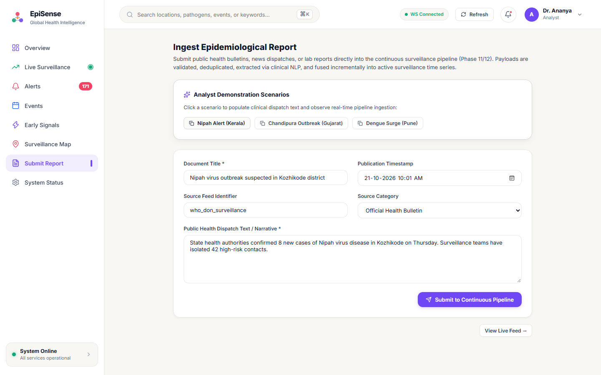

### A. What the Screen Displays
An interactive ingestion portal for operational surveillance analysts to enter new public health bulletins, lab feeds, or media dispatches directly into the running pipeline.

### B. Purpose of the Screen
Demonstrates real-time incremental processing, pipeline failure isolation, deduplication, and WebSocket broadcast fan-out.

### C. Major Form Elements
1. **Analyst Demonstration Scenarios (3 Quick Preset Buttons):**
   - `Nipah Alert (Kerala)`: Auto-populates a confirmed Kozhikode Nipah dispatch.
   - `Chandipura Outbreak (Gujarat)`: Auto-populates acute encephalitis cluster text.
   - `Dengue Surge (Pune)`: Auto-populates Pune municipal corporation dengue surge text.
2. **Form Fields:**
   - `Document Title *`: e.g., *"Nipah virus outbreak suspected in Kozhikode district"*
   - `Publication Timestamp`: e.g., *"21-10-2026 10:01 AM"* with calendar picker.
   - `Source Feed Identifier`: e.g., `who_don_surveillance`
   - `Source Category`: Dropdown (`Official Health Bulletin`, `News Media`, `Lab Report`, `Public Syndication`).
   - `Public Health Dispatch Text / Narrative *`: Multi-line textarea for raw text.
3. **Action Button:**
   - `Submit to Continuous Pipeline` (Primary brand purple button).
   - Bottom right link: `View Live Feed →` (navigates to Live Surveillance view).

---

## 10. Screen 08 — System Status & Telemetry (`08_system_status.png`)

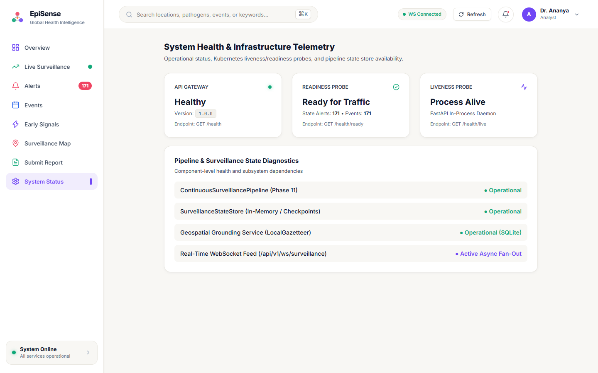

### A. What the Screen Displays
Infrastructure diagnostics, Kubernetes-style liveness/readiness probe indicators, pipeline health, and state store telemetry.

### B. Purpose of the Screen
Provides site reliability engineers (SRE) and surveillance administrators with live verification of backend health, memory state, and database connectivity.

### C. Major Telemetry Cards & Diagnostics
1. **API Gateway Card:**
   - Status: `Healthy` (Green dot).
   - Version: `1.0.0`.
   - Endpoint: `GET /health`.
2. **Readiness Probe Card:**
   - Status: `Ready for Traffic` (Checkmark).
   - State Telemetry: `State Alerts: 171 • Events: 171`.
   - Endpoint: `GET /health/ready`.
3. **Liveness Probe Card:**
   - Status: `Process Alive` (Activity icon).
   - Daemon: `FastAPI In-Process Daemon`.
   - Endpoint: `GET /health/live`.
4. **Pipeline & Surveillance State Diagnostics List:**
   - `ContinuousSurveillancePipeline (Phase 11)`: `● Operational`
   - `SurveillanceStateStore (In-Memory / Checkpoints)`: `● Operational`
   - `Geospatial Grounding Service (LocalGazetteer)`: `● Operational (SQLite)`
   - `Real-Time WebSocket Feed (/api/v1/ws/surveillance)`: `● Active Async Fan-Out`

---

## 11. Screens 09 & 10 — Responsive Layouts at 800px Width

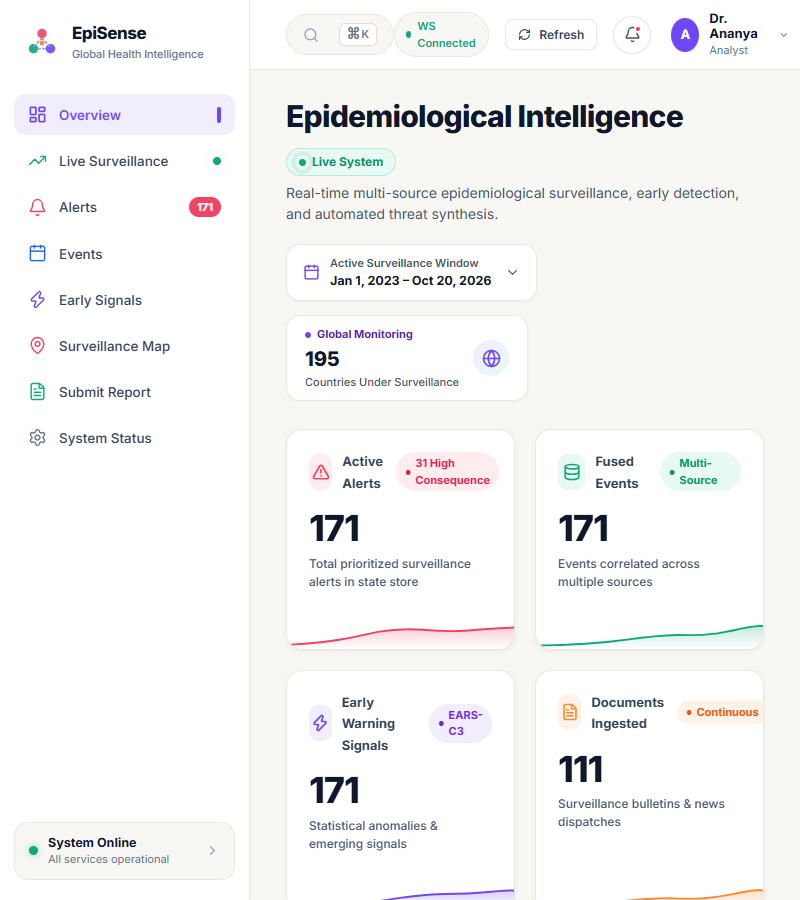
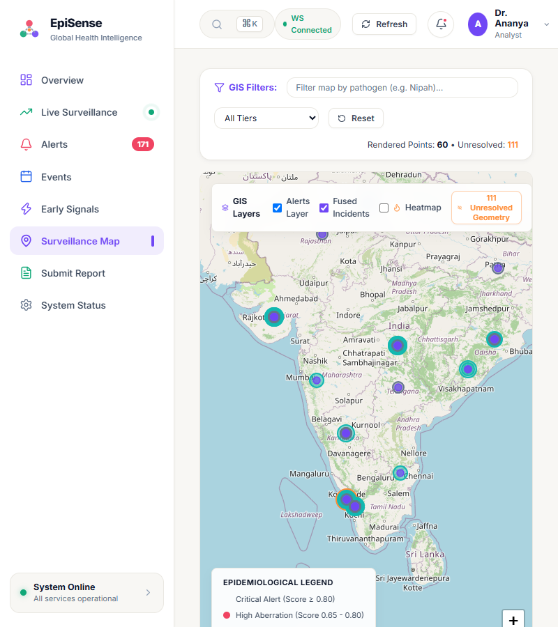

### A. Verification at 800x900 Viewport
- **Screen 09 (Overview Responsive):** The 4-column metric grid stacks gracefully into a 2-column or 1-column layout without overflow. Header badges compress, and the navigation sidebar remains accessible.
- **Screen 10 (Map Responsive):** The GIS filter controls collapse into a compact vertical stack, keeping the Leaflet map fully pannable and zoomable with full touch/mouse responsiveness.
