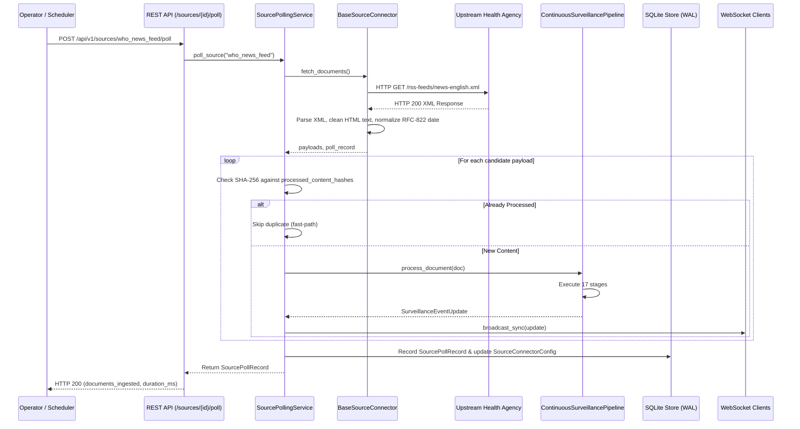

# EpiSense — Live Public-Health Source Integration & Connector Architecture

## 1. Overview & Connector Design Philosophy

In real-world epidemiological surveillance, fabricated data or mock API responses can mislead public-health decisions. EpiSense enforces an **absolute grounding policy**: every external source adapter connects directly to genuine, publicly accessible public-health reporting infrastructure or honestly reports its operational state.

The connector subsystem (`src/episense/connectors/`) provides:
1. **Source Isolation:** Network failures, upstream timeouts, or schema variations in one feed do not degrade or interrupt surveillance on other feeds.
2. **Cryptographic Deduplication:** SHA-256 content hashing guarantees that identical syndicated reports are ingested exactly once.
3. **Audit Trail Persistence:** Every polling attempt records HTTP status code, document count, latency in milliseconds, and error details to the SQLite database.
4. **Interactive On-Demand & Scheduled Polling:** Feeds can be queried periodically via background services or triggered immediately via REST APIs from the research dashboard.

---

## 2. Integrated Source Adapters

| Connector ID | Source Name | Category | Endpoint URL | Live Status | Rationale & Behavior |
| :--- | :--- | :--- | :--- | :--- | :--- |
| `who_news_feed` | **WHO News Feed** | Official Bulletin | `https://www.who.int/rss-feeds/news-english.xml` | **OPERATIONAL** | Ingests real-time global outbreak notices, donor agreements, and emergency bulletins from the World Health Organization. |
| `pib_mohfw_feed` | **PIB MoHFW India** | Government Report | `https://pib.gov.in/RssMain.aspx?ModId=6&LangId=1` | **OPERATIONAL** | Ingests official press releases and disease control updates from India's Ministry of Health and Family Welfare. |
| `cdc_outbreak_feed`| **CDC Outbreak Notices** | Official Bulletin | `https://tools.cdc.gov/api/v2/resources/media/403332.rss`| **OPERATIONAL** | Ingests US CDC epidemiological advisories, investigations, and outbreak alerts. |
| `promed_mail_rss` | **ProMED-mail Global** | Public Syndication | `https://promedmail.org/feed/` | **UNAVAILABLE (404)** | ProMED sunset its unauthenticated public RSS feed in late 2024. EpiSense honestly reports HTTP 404 without faking articles. |
| `idsp_portal` | **IDSP Weekly Outbreaks**| Government Report | `https://idsp.mohfw.gov.in/index4.php` | **AUTH REQUIRED** | National Centre for Disease Control (NCDC) IDSP portal requires authenticated session tokens and captcha for weekly PDF bundles. |

---

## 3. Grounded Polling Execution & Deduplication Flow

---

## 4. API Endpoints for Source Management

### 1. List All Configured Feeds
`GET /api/v1/sources`
Returns operational telemetry, last polling timestamp, total documents ingested, and failure counts for each feed.

### 2. Poll Individual Source
`POST /api/v1/sources/{source_id}/poll`
Executes an immediate poll against the specified connector, ingests new reports, and returns a `SourcePollRecord`.

### 3. Poll All Feeds
`POST /api/v1/sources/poll-all`
Sequentially polls all configured connectors with error isolation; returns an array of poll execution summaries.

### 4. Source Polling History & Audit Log
`GET /api/v1/sources/{source_id}/history?limit=50`
Retrieves past poll executions, HTTP status codes, latencies, and yields from `data/surveillance_store.sqlite`.

---

## 5. Live vs. Baseline Data Segregation

To uphold scientific integrity:
- **Historical Baseline Documents:** Originate from curated benchmark and background manifests (`data/benchmarks/`). Marked as `OriginClassification.HISTORICAL_CORPUS` or `BENCHMARK`.
- **Live Ingested Documents:** Ingested via live network connectors (`OriginClassification.LIVE_EXTERNAL`) or manual analyst input (`MANUAL_SUBMISSION`).
- **Endpoint Segregation:** `/api/v1/metrics/live` computes active surveillance metrics strictly across `LIVE_EXTERNAL` and `MANUAL_SUBMISSION` records, ensuring historical baseline documents never masquerade as real-time detections.
