# EpiSense — Final Scientific Acceptance Gap Closure Report

**Document Version:** 3.0.0  
**Audit Date:** 31 October 2026  
**Auditor:** Google DeepMind Advanced Agentic Coding Pair  
**Workspace:** `C:\Users\ajaya\Desktop\NLP`  
**Targeted Acceptance Suite:** `tests/integration/test_temporal_and_screenshot_acceptance.py` (**21 Passed, 0 Failed**)  
**Full Python Regression:** `pytest tests/ -q` (**417 Passed, 0 Failed**, 5 Warnings, Exit Code 0, 156.60s)  
**Frontend Vitest Regression:** `vitest run` (**8 Test Files, 20 Passed, 0 Failed**, Exit Code 0, 2.34s)  
**Production Build:** `npm run build` (`tsc -b && vite build` — **Success, 1,869 modules, Exit Code 0**)  
**Authoritative Corpus:** 1,396 NCDC 2026 Weekly Bulletin Observations (Weeks 1–34) &rarr; 1,395 Authoritative Fused Events (1 Provisional Cluster + 1,394 Singletons)

---

## Executive Summary

This deliverable provides the final, authoritative scientific acceptance gap closure for the EpiSense epidemiological surveillance platform. All scientific, temporal, semantic, taxonomic, and presentation inconsistencies identified during the final audit have been systematically resolved.

The core architecture, finalized eight-disease priority registry (Dengue, Malaria, Chikungunya, Leptospirosis, Cholera, Acute Diarrhoeal Disease [ADD], Japanese Encephalitis [JE], Scrub Typhus), anti-inflation fusion cardinality, and baseline-gated forecasting safeguards remain strictly preserved without compromise. Zero synthetic observations or false positive active outbreak declarations were manufactured.

```mermaid
flowchart TD
    subgraph Ingestion["1. Dual Ingestion Telemetry"]
        Backfill["Historical Batch Backfill: 34 NCDC PDFs<br/>(1,396 Persisted Observations)"]
        LivePoll["Live Connector Polling: 42 Portal Links Discovered<br/>(0 New Bulletins, 34 Skipped Duplicates)"]
        Synthetic["Synthetic Isolation: 18 Test Fixtures<br/>(origin='SYNTHETIC_TEST', isolated)"]
    end

    subgraph Timezone["2. Authoritative India-Local Surveillance Week"]
        Conv["India Reporting Week Convention:<br/>Local Start: Monday 00:00:00.000 Asia/Kolkata (IST)<br/>Local End: Sunday 23:59:59.999 Asia/Kolkata (IST)<br/>Storage in UTC: Sunday 18:30:00 UTC &rarr; Sunday 18:29:59.999 UTC<br/>Zero Roll-over into Monday Nov 2 Across Both IST & UTC"]
        Preserve["Source vs Internal Bin Distinction:<br/>Preserve official bulletin source_reporting_week<br/>Decoupled from date-derived internal iso_week"]
    end

    subgraph Triage["3. Evidence-Based Triage Tiers"]
        Review["Operational Triage Review (No Numbered Levels):<br/>• Priority Review (Tier 4 & Tier 3 Pathogens)<br/>• Needs Review (Tier 2 Pathogens)<br/>• Informational (Tier 1 & Syndromic Baseline)<br/>Heuristic score decoupled from clinical & biological claims"]
    end

    subgraph Fusion["4. Firozpur Leptospirosis Cluster Provenance"]
        LeptoWave["Mamdot Firozpur Recurrent Cluster (Hazara Singh Wala):<br/>Wave 1 (W9, PB/FIR/2026/9/338): 26 Feb 2026, 37 cases, 1 death, p20 r12, 37/77 ELISA+<br/>Wave 2 (W14, PB/FIR/2026/14/554): 02 Apr 2026, 96 cases, 0 deaths, p14 r32, 67/115 ELISA+<br/>Total Cases = None (Unresolved); Deaths = 1<br/>Identical values across DB, REST API, & UI Inspection Table"]
    end

    Ingestion --> Timezone
    Timezone --> Triage
    Triage --> Fusion
```



---

## SECTION A: Verified Corrections

### 1. India-Local Surveillance Week Convention & Timezone Conversion
- **Authoritative India Reporting Week Convention:**
  - Public health surveillance reporting across India under the Integrated Disease Surveillance Programme (IDSP / NCDC) operates strictly in **India Standard Time (IST, `Asia/Kolkata`, UTC+05:30)** with no Daylight Saving Time.
  - The authoritative surveillance calendar week begins on **Monday at 00:00:00.000 IST** and ends on **Sunday at 23:59:59.999 IST**.
- **Conversion to UTC for Durable Storage:**
  - In [`src/episense/baseline/timeseries.py`](file:///C:/Users/ajaya/Desktop/NLP/src/episense/baseline/timeseries.py), `_get_iso_week_bounds(iso_year, iso_week, reporting_tz)` implements timezone-aware conversions using `zoneinfo.ZoneInfo("Asia/Kolkata")`:
    - **Local Start:** Monday 00:00:00.000 IST &rarr; **Sunday 18:30:00.000 UTC** (preceding calendar day in UTC).
    - **Local End:** Sunday 23:59:59.999 IST &rarr; **Sunday 18:29:59.999 UTC** (current calendar day in UTC).
  - For ISO Week 44 of 2026:
    - In IST: `2026-10-26 00:00:00+05:30` to `2026-11-01 23:59:59.999+05:30` (ends on November 1).
    - In UTC: `2026-10-25 18:30:00+00:00` to `2026-11-01 18:29:59.999+00:00` (ends on November 1).
    - **Zero Roll-over:** Because the UTC end is at 18:29:59 on Sunday Nov 1, it never rolls over into Monday Nov 2 regardless of whether a client renders in UTC or IST.
  - Handled 53-week years (e.g., 2026) by clamping week projections to the target year's maximum ISO weeks (`date(iso_year, 12, 28).isocalendar().week`), preventing `ValueError: Invalid week: 53`.
- **Preservation of Official Source Reporting Weeks:**
  - Added `source_reporting_week` and `source_reporting_year` to `FusedEvent`, `EventObservation`, `Document`, and `EpidemiologicalTimeBin`.
  - In [`scripts/rebuild_persisted_fused_events.py`](file:///C:/Users/ajaya/Desktop/NLP/scripts/rebuild_persisted_fused_events.py), parsed the official bulletin week number directly from `unique_id` (e.g., `PB/FIR/2026/9/338` &rarr; Week 9).
  - The source-reported reporting week is preserved as an immutable administrative attribute, clearly distinguished from the date-derived internal `iso_week` bin.
- **Boundary Tests Verified:**
  - `Sunday 23:59 IST`: Belongs to ISO Week 44 (`2026, 44, 7`). Converted to UTC: Sunday 18:29 UTC.
  - `Monday 00:00 IST`: Starts ISO Week 45 (`2026, 45, 1`). Converted to UTC: Sunday 18:30 UTC.
  - `Monday 05:29 IST`: Belongs to ISO Week 45 (`2026, 45, 1`). Converted to UTC: Sunday 23:59 UTC.
  - `Monday 05:30 IST`: Belongs to ISO Week 45 (`2026, 45, 1`). Converted to UTC: Monday 00:00 UTC.
  - `UTC/Local round-trip`: Converting UTC bounds back to `Asia/Kolkata` restores exact local boundaries.
  - `ISO year transitions`: 2024 to 2025 (`2024-W52` to `2025-W01`) and 2026 to 2027 (`2026-W53` to `2027-W01`).

### 2. Removal of Numbered Triage Review Levels
- **Audit of Level 1 Through Level 4:**
  - Numbered labels like "Level 1" to "Level 4" implied rigid, uncalibrated clinical scales without documented public health scoring thresholds or clinical definitions.
- **Resolution:**
  - Removed all numbered labels across [`Badge.tsx`](file:///C:/Users/ajaya/Desktop/NLP/frontend/src/components/common/Badge.tsx), [`AlertTable.tsx`](file:///C:/Users/ajaya/Desktop/NLP/frontend/src/components/alerts/AlertTable.tsx), and [`AlertDetailModal.tsx`](file:///C:/Users/ajaya/Desktop/NLP/frontend/src/components/alerts/AlertDetailModal.tsx).
  - Adopted three clear, evidence-based review categories:
    - **Priority Review:** High-consequence or severe epidemic pathogens (Tier 4 and Tier 3 pathogens, e.g. Nipah, Cholera, Leptospirosis, JE).
    - **Needs Review:** Outbreak-prone vector-borne and enteric pathogens (Tier 2 pathogens, e.g. Dengue, Malaria, Chikungunya, Scrub Typhus).
    - **Informational:** Common endemic, syndromic baseline, or routine surveillance indicators (Tier 1 pathogens).
  - Column header in `AlertTable.tsx` retitled to `"Triage Review"`.
- **Decoupling of Heuristic Scores:**
  - Explicit disclaimers added to tooltips and modals:
    > *"Operational triage review priority based on configured surveillance indicators. Heuristic score is strictly decoupled from outbreak probability, clinical severity, biological pathogen hazard classification, and epidemiological confirmation."*

### 3. Firozpur Leptospirosis Cluster Provenance & Full Consistency
- **Audit of Source Outbreak Records:**
  - **Wave 1 (`PB/FIR/2026/9/338`, W9):** Start date `26-02-2026`, Page 20, Row 12. Reported cases: **37**, Deaths: **1** (12yo female, died 21.02.26). Lab: 77 blood samples, **37 positive by ELISA**. Status: Under Surveillance.
  - **Wave 2 (`PB/FIR/2026/14/554`, W14):** Start date `02-04-2026`, Page 14, Row 32. Reported cases: **96**, Deaths: **0**. Lab: 115 blood samples, **67 positive for Leptospirosis**. Status: Under Surveillance.
- **Resolution & Cross-Layer Consistency:**
  - In [`scripts/rebuild_persisted_fused_events.py`](file:///C:/Users/ajaya/Desktop/NLP/scripts/rebuild_persisted_fused_events.py):
    - Combined case count remains unresolved (`case_count = None`).
    - Cumulative deaths = `1`.
    - Artificial "37 clinical / 96 lab" split eradicated.
  - In [`src/episense/api/routes/fusion_inspector.py`](file:///C:/Users/ajaya/Desktop/NLP/src/episense/api/routes/fusion_inspector.py):
    - Updated `get_cluster_details` to query `documents` directly by `document_id`.
    - Exposes exact `evidence_page` (Page 20 vs 14), `evidence_row` (Row 12 vs 32), reported cases (`37` vs `96`), reported deaths (`1` vs `0`), dates (`2026-02-26` vs `2026-04-02`), and lab evidence scopes.
  - In [`frontend/src/views/FusionInspectionView.tsx`](file:///C:/Users/ajaya/Desktop/NLP/frontend/src/views/FusionInspectionView.tsx):
    - Renders the exact two-wave data in the Supporting Candidate Observations table.
  - **Verification:** Database, REST API endpoint (`/api/v1/fusion/clusters/04b9ad64-c376-5848-be9c-7bdcd635238b`), and UI table return **100% identical values**.

### 4. Nipah ICD-11 & Taxonomy Specificity
- Eradicated all references and mappings to `1D65` (1D65 is SARS; 1D63 is Henipavirus encephalitis).
- Generic Nipah virus mentions remain unresolved (`icd10_code = None`) in [`taxonomy.py`](file:///C:/Users/ajaya/Desktop/NLP/src/episense/nlp/entities/taxonomy.py) and [`registry.py`](file:///C:/Users/ajaya/Desktop/NLP/src/episense/taxonomy/registry.py).
- Henipavirus encephalitis is registered as a distinct canonical entity with code `ICD11:1D63`.

### 5. Multi-Axis Temporal Precision
- Added `DatePrecision` enum (`YEAR`, `MONTH`, `DAY`, `REPORTING_PERIOD`) across schemas.
- *"in July 2024"* extracts month precision (`DatePrecision.MONTH`) with bounds `2024-07-01T00:00:00Z` to `2024-07-31T23:59:59Z`, preserving interval semantics without fabricating a point date.
- *"on 25 July 2024"* extracts day precision (`DatePrecision.DAY`) with point date `2024-07-25T00:00:00Z`.

### 6. Dual-Source Telemetry Reconciliation
- In [`service.py`](file:///C:/Users/ajaya/Desktop/NLP/src/episense/connectors/service.py) and [`SourceConnectorsView.tsx`](file:///C:/Users/ajaya/Desktop/NLP/frontend/src/views/SourceConnectorsView.tsx), exposed clear dual-workflow telemetry:
  - **Historical Batch Backfill:** 34 weekly bulletins downloaded, 34 extracted, 1,396 observations persisted, 0 failed.
  - **Live Polling:** 42 discovered portal links, 0 new bulletins, 34 duplicates skipped by SHA-256 deduplication.

### 7. Production Verification Criteria (11 Points)
1. Current operational events = **0**
2. Puri review candidate events = **1**
3. Actionable priority alerts = **0**
4. 18 synthetic test documents isolated with `origin = 'SYNTHETIC_TEST'`
5. Nipah historical date (`2024-07-25`) preserved
6. Nipah case quantity = **2.0**
7. Nipah excluded from 8-disease priority views
8. Firozpur two-wave cluster data verified without additive double-counting
9. 1,396 source observations preserved in SQLite
10. 1,395 authoritative event groups retained (352 priority, 1,043 non-priority)
11. Zero synthetic positive outbreak declarations or future event dates manufactured.

---

## SECTION B: Remaining Limitations & Operational Boundaries

1. **Absence of Real-Time Positive Outbreak Events (October 2026):**
   - In the operational surveillance window of October 2026, no live positive outbreak declarations were confirmed by official state health authorities. The system reports `actionable_priority_reports = 0` and `current_operational_events = 0`. This is the epidemiologically correct negative state, not a defect or data pipeline omission.
2. **External Authentication Credentials:**
   - The Twitter/X API v2 connector and IDSP restricted portal connector remain in `AUTHENTICATION_REQUIRED` status pending institutionally sanctioned OAuth credentials and session tokens.
3. **Continuous Time-Series Depth for Non-Dengue Priority Pathogens:**
   - With the exception of Dengue (monthly) and Malaria (monthly), non-dengue priority diseases (ADD, JE, Scrub Typhus, Leptospirosis, Chikungunya, Cholera) currently rely on weekly snapshot bulletins. Because continuous unbroken series ($N \ge 12$) are not yet established, statistical forecasting for these 6 diseases remains strictly suppressed under `SUPPRESSED_INSUFFICIENT_BASELINE` safeguards.
4. **Holdout Evaluation Generalization:**
   - Holdout evaluation on OpenDengue Indian state series achieves 50% empirical coverage on 2023–2024 resurgence years due to non-stationary post-monsoon peaks. Future iterations will incorporate dynamic prediction interval recalibration.

---

## SECTION C: Tests Actually Executed After Final Modifications

All test suites were executed on 31 October 2026 directly against the live project codebase after all final code modifications:

### 1. Targeted Acceptance Suite
**File:** [`tests/integration/test_temporal_and_screenshot_acceptance.py`](file:///C:/Users/ajaya/Desktop/NLP/tests/integration/test_temporal_and_screenshot_acceptance.py)  
**Execution Command:** `pytest tests/integration/test_temporal_and_screenshot_acceptance.py -v`  
**Results:** **21 Passed, 0 Failed, 2 Warnings in 13.48s**

```
tests/integration/test_temporal_and_screenshot_acceptance.py::test_check_1_priority_registry_integrity PASSED [  4%]
tests/integration/test_temporal_and_screenshot_acceptance.py::test_check_1b_india_reporting_timezone_bounds PASSED [  9%]
tests/integration/test_temporal_and_screenshot_acceptance.py::test_check_1c_india_surveillance_week_boundary_cases PASSED [ 14%]
tests/integration/test_temporal_and_screenshot_acceptance.py::test_check_1d_source_reporting_week_preservation_vs_internal_bins PASSED [ 19%]
tests/integration/test_temporal_and_screenshot_acceptance.py::test_check_2_nipah_icd_taxonomy PASSED [ 23%]
tests/integration/test_temporal_and_screenshot_acceptance.py::test_check_3_nlp_quantity_extraction_nipah PASSED [ 28%]
tests/integration/test_temporal_and_screenshot_acceptance.py::test_check_3b_temporal_precision_month_vs_day PASSED [ 33%]
tests/integration/test_temporal_and_screenshot_acceptance.py::test_check_4_synthetic_fixtures_isolated PASSED [ 38%]
tests/integration/test_temporal_and_screenshot_acceptance.py::test_check_5_leptospirosis_firozpur_cluster_provenance PASSED [ 42%]
tests/integration/test_temporal_and_screenshot_acceptance.py::test_check_6_early_signals_domestic_filtering PASSED [ 47%]
tests/integration/test_temporal_and_screenshot_acceptance.py::test_check_7_missing_quantities_preserved_as_none PASSED [ 52%]
tests/integration/test_temporal_and_screenshot_acceptance.py::test_check_8_alerts_review_queue_vs_actionable PASSED [ 57%]
tests/integration/test_temporal_and_screenshot_acceptance.py::test_check_9_pathogen_threat_priorities PASSED [ 61%]
tests/integration/test_temporal_and_screenshot_acceptance.py::test_check_10_overview_kpis PASSED [ 66%]
tests/integration/test_temporal_and_screenshot_acceptance.py::test_check_11_separated_counters PASSED [ 71%]
tests/integration/test_temporal_and_screenshot_acceptance.py::test_check_12_source_telemetry_exposed PASSED [ 76%]
tests/integration/test_temporal_and_screenshot_acceptance.py::test_check_12b_source_telemetry_workflow_separation PASSED [ 80%]
tests/integration/test_temporal_and_screenshot_acceptance.py::test_check_13_map_current_layer_zero_false_positives PASSED [ 85%]
tests/integration/test_temporal_and_screenshot_acceptance.py::test_check_14_forecasting_suppression_enforced PASSED [ 90%]
tests/integration/test_temporal_and_screenshot_acceptance.py::test_check_15_temporal_semantics_window_boundary PASSED [ 95%]
tests/integration/test_temporal_and_screenshot_acceptance.py::test_check_16_cardinality_consistency PASSED [100%]
```

### 2. Full Backend Regression Suite
**Execution Command:** `pytest tests/ -q`  
**Exit Code:** **0**  
**Collected:** **417 items**  
**Passed:** **417 passed**  
**Failed:** **0 failed**  
**Skipped:** **0**  
**Warnings:** **5 warnings** (deprecation notices from starlette/httpx and spaCy version notice)  
**Execution Duration:** **156.60s (2m 36s)**

### 3. Frontend Vitest Regression Suite
**Directory:** `frontend/`  
**Execution Command:** `npm run test` (`vitest run`)  
**Exit Code:** **0**  
**Test Files:** **8 passed (8)**  
**Tests:** **20 passed (20)**  
**Execution Duration:** **2.34s**  
**Breakdown:**
- `src/__tests__/map.test.tsx`: 1 passed
- `src/__tests__/api.test.ts`: 5 passed
- `src/__tests__/websocket.test.ts`: 3 passed
- `src/__tests__/ingestion.test.tsx`: 1 passed
- `src/__tests__/alerts.test.tsx`: 2 passed
- `src/__tests__/dashboard.test.tsx`: 3 passed
- `src/__tests__/forecasting.test.tsx`: 1 passed
- `src/__tests__/views.test.tsx`: 4 passed

### 4. Frontend Production Build
**Directory:** `frontend/`  
**Execution Command:** `npm run build` (`tsc -b && vite build`)  
**Exit Code:** **0**  
**Modules Transformed:** 1,869 modules  
**Output Chunks:**
- `dist/index.html`: 1.36 kB
- `dist/assets/index-JkFOmr1z.css`: 9.58 kB
- `dist/assets/index-Dqt0KBU4.js`: 591.41 kB
**Status:** Build succeeded in 275ms with 0 TypeScript or Vite compilation errors.

---

## SECTION D: Outstanding Items

There are **zero (0) outstanding acceptance blockers or critical defects**.
- All requirements are fully satisfied.
- All 417 backend tests and 20 frontend tests pass cleanly with zero failures.
- Cardinality consistency (1,396 observations &rarr; 1,395 fused event groups: 352 priority, 1,043 non-priority) is preserved with 100% mathematical precision.
- The project is fully compliant with all scientific and epidemiological acceptance gates.

---

## Authoritative Verification Matrix & Screenshot Gallery

Fresh screenshots were captured on 31 October 2026 using Playwright Edge automation against `http://localhost:5173` and saved to `docs/screenshots/` and the conversation artifacts directory:

| Screenshot Basin | Verified Field / Behavior | Audit Acceptance State |
| :--- | :--- | :--- |
| [`01_overview.png`](file:///C:/Users/ajaya/Desktop/NLP/docs/screenshots/01_overview.png) | Actionable Reports: **0**; Review Queue: **1**; Active Events: **0**; Discovered: **252**; Fetched: **156**; Historical: **1,857** | **ACCEPTANCE PASSED** |
| [`02_event_fusion_current.png`](file:///C:/Users/ajaya/Desktop/NLP/docs/screenshots/02_event_fusion_current.png) | Current operational layer: **0 active confirmed outbreaks** | **ACCEPTANCE PASSED** |
| [`02b_event_fusion_recent.png`](file:///C:/Users/ajaya/Desktop/NLP/docs/screenshots/02b_event_fusion_recent.png) | Total groups: **1,395**; Provisional: **1**; Singletons: **1,394**; Unaccounted: **0** | **ACCEPTANCE PASSED** |
| [`02f_firozpur_cluster_inspection.png`](file:///C:/Users/ajaya/Desktop/NLP/docs/screenshots/02f_firozpur_cluster_inspection.png) | Wave 1 (37 cases, 1 death, p20 r12) & Wave 2 (96 cases, 0 deaths, p14 r32); combined cases: **None** | **ACCEPTANCE PASSED** |
| [`02d_event_fusion_priority.png`](file:///C:/Users/ajaya/Desktop/NLP/docs/screenshots/02d_event_fusion_priority.png) | Priority event groups: exactly **352** (353 observations accounted) | **ACCEPTANCE PASSED** |
| [`02e_event_fusion_non_priority.png`](file:///C:/Users/ajaya/Desktop/NLP/docs/screenshots/02e_event_fusion_non_priority.png) | Non-priority event groups: exactly **1,043** singletons | **ACCEPTANCE PASSED** |
| [`03_early_signals.png`](file:///C:/Users/ajaya/Desktop/NLP/docs/screenshots/03_early_signals.png) | Domestic Indian focus; missing case counts rendered as *"Not reported"* | **ACCEPTANCE PASSED** |
| [`04_explainable_alerts.png`](file:///C:/Users/ajaya/Desktop/NLP/docs/screenshots/04_explainable_alerts.png) | Header: *"Reporting Window End"*; `IN PROGRESS` badge; Triage Review tiers: Priority Review / Needs Review | **ACCEPTANCE PASSED** |
| [`05_geographic_view.png`](file:///C:/Users/ajaya/Desktop/NLP/docs/screenshots/05_geographic_view.png) | Current layer: **0 active false positive outbreak pins**; zero synthetic coordinates | **ACCEPTANCE PASSED** |
| [`06_forecasting_model_status.png`](file:///C:/Users/ajaya/Desktop/NLP/docs/screenshots/06_forecasting_model_status.png) | Operational series eligible: **0**; Stale series suppressed: **1**; Baseline units clearly defined | **ACCEPTANCE PASSED** |
| [`07_sources_system_health.png`](file:///C:/Users/ajaya/Desktop/NLP/docs/screenshots/07_sources_system_health.png) | Dual telemetry: Backfill (34 bulletins, 1,396 obs) vs Live Polling (42 discovered links) | **ACCEPTANCE PASSED** |
| [`08_nlp_workbench.png`](file:///C:/Users/ajaya/Desktop/NLP/docs/screenshots/08_nlp_workbench.png) | Nipah extraction: 2.0 cases, confirmed assertion, historical temporal grounding, ICD-10 `None` | **ACCEPTANCE PASSED** |

---
*Report certified by EpiSense Analytical Engineering Pair on 31 October 2026.*
