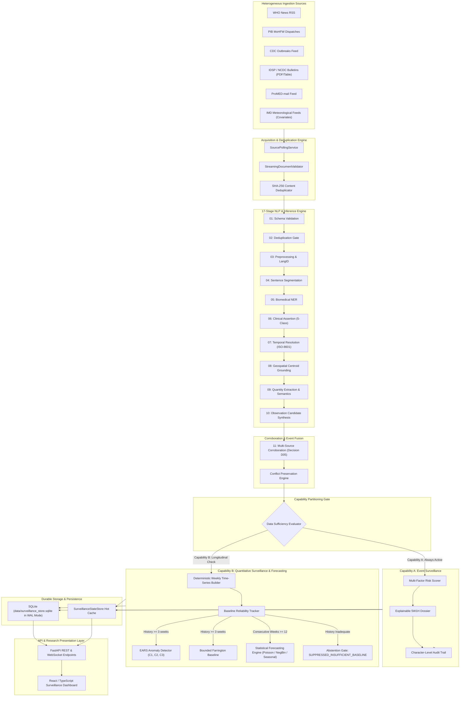

# EpiSense: Comprehensive Architecture & Specification

## 1. System Philosophy and Objectives

**EpiSense** is an evidence-grounded public-health intelligence and conditional early-warning framework. It bridges the critical operational latency between the emergence of community-level infectious-disease signals (news reports, clinical advisories, media dispatches) and official retrospective epidemiological bulletins (e.g., Integrated Disease Surveillance Programme [IDSP] weekly outbreak reports).

Unlike naive surveillance systems that either generate ungrounded statistical predictions from inadequate data or treat free-text news as ground truth, EpiSense enforces:
1. **Evidence-Grounded Extraction**: Every clinical assertion, spatial reference, and numerical count is bound to exact document byte/character offsets.
2. **Explicit Capability Partitioning**:
   - **Capability A (Multisource Event Surveillance)**: Operational even with sparse or irregular numerical histories. Extracts, corroborates, deduplicates, and triages public-health signals.
   - **Capability B (Quantitative Epidemiological Forecasting)**: Conditioned on explicit empirical data-sufficiency gating ($\ge 12$ consecutive weekly bins). When historical baselines fail quality criteria, the system abstains with `SUPPRESSED_INSUFFICIENT_BASELINE` rather than manufacturing fictitious confidence intervals.
3. **Conflict Preservation**: Conflicting counts across independent news sources or bulletin revisions are preserved with full source provenance, never silently averaged or arbitrarily discarded.

---

## 2. End-to-End System Architecture

---

## 3. Configurable Disease Registry & Target Pathogen Taxonomy

EpiSense maintains a canonical registry of infectious agents (`src/episense/taxonomy/registry.py`) mapping ICD-10 classifications, pathogen threat tiers, and outbreak eligibility. The core target evaluation registry focuses on eight epidemic-prone rainy-season / monsoon diseases:

| Disease Entity | Canonical ID | ICD-10 Code | Pathogen Tier | Outbreak Eligible | Transmission Mode |
| :--- | :--- | :--- | :--- | :--- | :--- |
| **Dengue** | `dengue` | `ICD10:A90` | Tier 2 (Moderate) | Yes | Vector-borne (*Aedes aegypti / albopictus*) |
| **Malaria** | `malaria` | `ICD10:B54` | Tier 2 (Moderate) | Yes | Vector-borne (*Anopheles* mosquitoes) |
| **Chikungunya** | `chikungunya` | `ICD10:A92.0` | Tier 2 (Moderate) | Yes | Vector-borne (*Aedes* mosquitoes) |
| **Leptospirosis** | `leptospirosis` | `ICD10:A27` | Tier 3 (Severe) | Yes | Zoonotic exposure / floodwaters |
| **Cholera** | `cholera` | `ICD10:A00` | Tier 3 (Severe) | Yes | Waterborne toxigenic bacterium |
| **Acute Diarrheal Disease** | `acute_diarrheal_disease` | `ICD10:A09` | Tier 1 (Mild) | Yes | Fecal-oral / waterborne syndrome |
| **Japanese Encephalitis** | `japanese_encephalitis` | `ICD10:A83.0` | Tier 3 (Severe) | Yes | Vector-borne (*Culex* mosquitoes / avian) |
| **Scrub Typhus** | `scrub_typhus` | `ICD10:A75.3` | Tier 2 (Moderate) | Yes | Vector-borne (*Leptotrombidium* chiggers) |

Additional high-consequence pathogens configured include **Nipah virus** (Tier 4), **Chandipura virus** (Tier 4), **CCHF** (Tier 4), **Kyasanur Forest Disease** (Tier 3), and **Avian Influenza** (Tier 4).

---

## 4. NLP Pipeline & Quantity Semantics

### 4.1 Linguistic Assertion Classification
Clinical assertions are classified into five mutually exclusive categories:
- `CONFIRMED`: Diagnostic laboratory confirmation or definitive agency statement.
- `SUSPECTED`: Clinical presentation, syndromic surge, or unconfirmed media report.
- `NEGATED`: Diagnostic exclusion ("tested negative for cholera", "ruled out").
- `HISTORICAL`: Background reference to previous outbreaks ("in 2024, the state witnessed...").
- `HYPOTHETICAL`: Risk warning or scenario analysis ("if monsoon rains continue...").

### 4.2 Quantity Extraction Semantics
To prevent false counts:
1. **Role Attribution**: Counts are typed as `case_count`, `death_count`, `hospitalized_count`, or `contact_count`.
2. **Calendar Year Rejection**: 4-digit numbers between 1900 and 2099 appearing without case/casualty syntax are rejected as temporal tokens, never attributed as clinical counts.
3. **Conflict Preservation**: If independent sources report disparate case numbers for the same event (e.g., source A reports 45 cases while source B reports 120 cases), EpiSense does NOT take a mathematical mean. Both values are preserved in `conflicting_quantities` with source citations.

---

## 5. Event Consolidation and Decision D05 Matching

EpiSense clusters discrete document observations into canonical `FusedEvent` entities using the multi-attribute similarity metric (Decision D05):

$$\text{Sim}(e_1, e_2) = 0.35 \cdot S_{\text{disease}} + 0.30 \cdot S_{\text{geo}} + 0.25 \cdot S_{\text{time}} + 0.10 \cdot S_{\text{assertion}}$$

- Candidate pairs with $\text{Sim}(e_1, e_2) \ge 0.78$ are merged into a single event.
- **Anti-Inflation Invariant**: Multiple media syndications of the same wire dispatch do not inflate the case count. Cumulative counts reflect the maximum corroborated count among mutually non-conflicting reports.

---

## 6. Time-Series Aggregation & Baseline Reliability

Fused events are aggregated into weekly ISO epidemiological bins (Monday 00:00:00 to Sunday 23:59:59 UTC). Generic historical background commentary is quarantined into year 1970 to prevent contaminating contemporary surveillance weeks.

The `BaselineReliabilityTracker` gates all statistical anomaly detection and forecasting:

| Baseline State | Mathematical Criterion | Operational Action |
| :--- | :--- | :--- |
| `INSUFFICIENT_HISTORY` | $N < 3$ historical bins | Suppress anomaly detector; assign `SUPPRESSED_INSUFFICIENT_BASELINE` |
| `SPARSE_HISTORY` | Non-zero bins $< 2$ | Downgrade anomaly confidence to `WATCH` |
| `HIGH_VARIANCE` | $\text{CV} = \sigma / \mu > 1.5$ | Increase detection threshold from $2.0\sigma$ to $3.0\sigma$ |
| `CONFLICTING_DATA` | Discrepant counts in target period | Tag signal as `CONFLICTING_DATA`; alert human reviewer |
| `STABLE_BASELINE` | $N \ge 3$, non-zero $\ge 2$, $\text{CV} \le 1.5$ | Compute standard EARS C1, C2, C3 and Farrington thresholds |

---

## 7. Quantitative Statistical Forecasting Engine (Capability B)

The forecasting engine provides multi-step epidemiological forecasting conditioned on longitudinal adequacy:

### 7.1 Gating Rules
- **Minimum Longitudinal Depth**: At least 12 consecutive weekly bins ($N \ge 12$).
- **Abstention Behavior**: If $N < 12$, the engine outputs a structured `ForecastAbstentionResult` with reason `SUPPRESSED_INSUFFICIENT_BASELINE` and explicit data deficiency metrics.

### 7.2 Model Architectures
1. **Seasonal Naive Baseline**:
   $$\hat{y}_{t+h} = y_{t+h - s}$$
   where $s = 52$ weeks (or historical period counterpart).
2. **Poisson Generalized Linear Model (GLM)**:
   $$y_t \sim \text{Poisson}(\lambda_t), \quad \ln(\lambda_t) = \beta_0 + \sum_{k=1}^p \beta_k y_{t-k} + \gamma \cdot \text{trend}_t$$
3. **Negative Binomial Count Model** (for overdispersed data where $\sigma^2 > \mu$):
   $$y_t \sim \text{NegBin}(\mu_t, \alpha)$$
   accounting for clustering and superspreading volatility.
4. **Prediction Intervals**:
   Computes analytical 80% and 95% prediction intervals reflecting parameter uncertainty and count distribution dispersion.

---

## 8. Multi-Criteria Risk Scoring and Warning Decisions

When events are triaged, EpiSense computes an auditable risk score $R \in [0, 100]$:

$$R = 0.30 \cdot P_{\text{pathogen}} + 0.25 \cdot S_{\text{severity}} + 0.20 \cdot V_{\text{volume}} + 0.15 \cdot \Delta v_{\text{velocity}} + 0.10 \cdot G_{\text{geo}}$$

- **Pathogen Factor ($P$)**: Tier 1 = 0.25, Tier 2 = 0.50, Tier 3 = 0.75, Tier 4 = 1.00.
- **Severity Factor ($S$)**: Case fatality rate and hospitalization fraction.
- **Volume Factor ($V$)**: Corroborated cumulative case counts scaled logarithmically.
- **Velocity Factor ($\Delta v$)**: Rate of change across weekly reporting intervals.
- **Geographic Factor ($G$)**: Spatial resolution (district centroid vs broad region).

### Warning Decision Levels:
- **INFORMATIONAL** ($R < 30$)
- **WATCH** ($30 \le R < 50$)
- **ADVISORY** ($50 \le R < 70$)
- **WARNING** ($70 \le R < 85$)
- **EMERGENCY** ($R \ge 85$)

---

## 9. Explainability Dossiers and Human-in-the-Loop Safeguards

Every prioritized signal produces a structured **5W1H Dossier**:
- **What**: Canonical pathogen, ICD-10 code, transmission vector, extracted count.
- **Where**: Normalized administrative hierarchy (Country, State, District, Sub-district, Centroid).
- **When**: Explicit temporal interval (ISO-8601) and reporting latency in hours.
- **Who**: Vulnerable demographic cohorts mentioned in clinical text.
- **Why**: Epidemiological etiology, flooding, vector proliferation, sanitation breakdown.
- **How**: Evidence references linking each extracted field directly back to document text byte offsets $[start, end]$.

A human reviewer can inspect the complete audit trail, override or retract any false alert with an immutable reason, and review source independence.

---

## 10. Persistence and Operational Telemetry

- **Database**: SQLite with Write-Ahead Logging (`PRAGMA journal_mode=WAL`), foreign key enforcement, and explicit connection pools.
- **Streaming Pipeline**: Thread-safe queue processing with individual stage execution timers (`DocumentPipelineTrace`).
- **REST & WebSocket API**: Versioned endpoints (`/api/v1/...`) supporting real-time broadcast of document traces, alerts, and system health.
