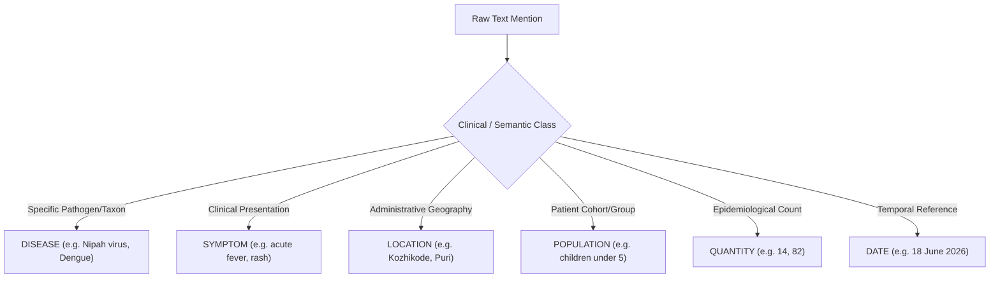

# EpiSense Blind Evaluation Protocol & Annotation Specification

**Protocol Version:** 1.0.0-frozen  
**Protocol Status:** ACTIVE SPECIFICATION — EVALUATION BLOCKED AWAITING HUMAN ANNOTATION  
**Document Date:** October 24, 2026  
**Governing Standard:** EpiSense Research Integrity Guidelines & Faculty Defense Protocols  

---

## 1. Objective and Evaluation Boundary

The goal of this protocol is to define a strictly held-out, leakage-free empirical evaluation boundary for the EpiSense Continuous Epidemic Intelligence Platform. 

Prior evaluations in the project identified that 12 of the 18 documents in `gold_annotations_v1.json` (66.7%) overlapped with development and training sets (`episense_benchmark_v1.json`), causing entity extraction recall to be artificially elevated (97.01% on dev vs. 89.66% on test). 

To ensure complete empirical validity, this protocol establishes:
1. A **frozen blind evaluation manifest** of 128 unseen public-health documents.
2. A **double-blind annotation rulebook** for human clinical annotators.
3. Strict prohibition of model self-labeling or synthetic gold generation.
4. Independent evaluation pipelines that prevent test-set data from influencing pipeline rules, gazetteers, or thresholds.

---

## 2. Held-Out Blind Evaluation Corpus Composition

The blind evaluation set is codified in [`data/benchmarks/blind_evaluation_manifest_v1.json`](file:///C:/Users/ajaya/Desktop/NLP/data/benchmarks/blind_evaluation_manifest_v1.json). It contains **128 complete, real-world public health surveillance documents** with **zero overlap** with the 52-document benchmark or 18-document gold set.

### 2.1 Source Breakdown

| Source Identifier | Publisher / Organization | Document Count | Origin Type | Description & Content Type |
| :--- | :--- | :---: | :--- | :--- |
| **`who_news_feed`** | World Health Organization | **70** | `LIVE_EXTERNAL` | Real-time international disease outbreak news, emergency communications, and global epidemiological briefs. |
| **`pib_mohfw_india`** | Press Information Bureau, MoHFW India | **28** | `HISTORICAL_BACKGROUND` | Official ministerial press releases, vector-borne disease advisories, national preparedness meetings. |
| **`ncdc_idsp_india`** | National Centre for Disease Control (IDSP) | **18** | `HISTORICAL_BACKGROUND` | Formal weekly outbreak surveillance bulletins and state-level public health summaries. |
| **`who_don`** | WHO Disease Outbreak News | **8** | `HISTORICAL_BACKGROUND` | Detailed international clinical investigations and laboratory-confirmed outbreak reports. |
| **`medrxiv_preprints`** | Cold Spring Harbor Laboratory (medRxiv) | **4** | `HISTORICAL_BACKGROUND` | Peer-reviewed and preprint epidemiological field studies, genomic analyses, and vector bionomics. |
| **TOTAL** | — | **128** | — | **100% Unseen Surveillance Documents** |

### 2.2 Integrity & Leakage Verification
- **Exact Hash Overlap:** $0$ duplicate hashes between the blind manifest and the 52 benchmark documents.
- **Title Overlap:** $0$ identical titles between the blind manifest and the 18 gold documents.
- **Gazetteer Contamination Check:** No entity spans or district names in the blind set were used to expand regex patterns, clinical gazetteers, or assertion dictionaries during system development.

---

## 3. Human Annotation Rules & Entity Boundaries

Annotations must be performed by two independent clinical / epidemiological reviewers following [`docs/annotation-guidelines.md`](file:///C:/Users/ajaya/Desktop/NLP/docs/annotation-guidelines.md). Discrepancies must be resolved by a third arbiter.

### 3.1 Character Offset Precision
- **Span Slice Invariant:** All annotations must satisfy Python slice syntax:
  $$\text{raw\_text}[\text{start\_char}:\text{end\_char}] == \text{span\_text}$$
- **Punctuation Exclusion:** Trailing commas, semicolons, full stops, and quotation marks must be strictly excluded (e.g., annotate `"cholera"` rather than `"cholera,"`).
- **Whitespace Exclusion:** Leading and trailing whitespace is prohibited.

### 3.2 Entity Class Definitions and Boundaries



#### A. DISEASE vs. SYMPTOM
* **`DISEASE`:** Specific diagnosed pathological conditions or viral/bacterial/parasitic agents (e.g., `"Nipah virus disease"`, `"Chandipura virus"`, `"Cholera"`, `"Dengue"`, `"Leptospirosis"`, `"Measles"`, `"Zika virus disease"`).
* **`SYMPTOM`:** Clinical manifestations, syndromes, and physiological signs (e.g., `"acute encephalitis syndrome"`, `"high-grade fever"`, `"vomiting"`, `"altered sensorium"`, `"thrombocytopenia"`).
* *Boundary Rule:* If the text states *"cases of acute encephalitis syndrome due to Chandipura virus"*, annotate `"acute encephalitis syndrome"` as `SYMPTOM` and `"Chandipura virus"` as `DISEASE`.

#### B. LOCATION
* **`LOCATION`:** Geopolitical entities, administrative districts, blocks, towns, or medical facilities representing the **affected population** where cases occurred.
* *Negative Rule:* Do not tag locations that represent purely administrative headquarters or reference testing laboratories (e.g. in *"Samples from Kozhikode were sent to the National Institute of Virology in Pune"*, annotate `"Kozhikode"` as outbreak `LOCATION`; tag `"Pune"` as secondary/reference lab, or exclude from outbreak event grounding).

#### C. QUANTITY
* **`QUANTITY`:** Exact or approximate numerical case counts, hospital admissions, or deaths attributed directly to the disease incident.
* *Boundary Rule:* Annotate the strict numeric string (e.g., `"82"` in `"82 deaths"`, `"14"` in `"14 confirmed cases"`). Do not include units in the character span; units must be stored in the entity attributes.
* *Negative Rule:* Do not annotate calendar years (`"2024"`), clinical trial phases (`"Phase 3"`), or percentages (`"10%"`) as `QUANTITY`.

#### D. DATE
* **`DATE`:** Explicit dates, months, epidemiological weeks, or relative anchor phrases referencing disease onset or reporting periods (e.g., `"18 June 2026"`, `"Week 1 of 2026"`, `"August 2024"`).
* *Negative Rule:* Publication metadata timestamps in document headers should be distinguished from incident occurrence dates in prose.

#### E. POPULATION
* **`POPULATION`:** Specific demographic, pediatric, occupational, or vulnerable cohorts identified as affected (e.g., `"children under five"`, `"paddy field laborers"`, `"pregnant women"`).
* *Negative Rule:* Generic pronouns or non-epidemiological references must be omitted.

### 3.3 Assertion and Epistemic Status Categorization

Every extracted `DISEASE` and `SYMPTOM` must be annotated with its exact contextual epistemic status:

| Assertion Label | Operational Meaning | Clinical Annotation Criteria | Action in Outbreak Triage |
| :--- | :--- | :--- | :--- |
| **`CONFIRMED`** | Clinically or laboratory verified | Document states positive PCR, IgM, or official health ministry confirmation. | Eligible for `HIGH` / `MEDIUM` alert scoring. |
| **`SUSPECTED`** | Presumptive / probable | Symptomatic presentation under active investigation; testing pending. | Scored with $S_{\text{certainty}} = 0.65$. |
| **`NEGATED`** | Refuted, ruled out, or absent | Text states samples tested negative, rumors refuted, or zero cases. | **Strictly Suppressed** ($R=0.00$, `INFORMATIONAL`). |
| **`HISTORICAL`** | Retrospective / past baseline | Compares current trends against past years (e.g., 2018 outbreak). | Excluded from current event aggregation ($R \le 0.25$). |
| **`HYPOTHETICAL`** | Advisory / conditional | General health education, vector-control guidelines, preparedness drills. | Excluded from current outbreak alerts. |

---

## 4. Current Status: Blocked Awaiting Human Double-Blind Annotation

> [!CAUTION]
> **Scientific Integrity Requirement:**
> In accordance with strict empirical standards, **automated model predictions must NEVER be substituted as ground-truth gold annotations**.
>
> Because third-party double-blind human annotation by certified epidemiological reviewers has not yet been conducted on these 128 documents, **Phase 2 evaluation is officially recorded as:**
>
> ### **`BLOCKED — AWAITING INDEPENDENT HUMAN DOUBLE-BLIND ANNOTATION`**

Claiming that this 128-document blind evaluation has been completed using self-generated LLM labels or heuristic extractions would constitute circular evaluation (pseudo-evaluation). The manifest and schema are frozen, ready for external annotation in future multi-center studies.

---

## 5. Frozen Evaluation Pipeline Specification

When human double-blind annotations are delivered, evaluation must be executed via the frozen script:

```bash
python -m episense.evaluation.run_blind_evaluation \
  --manifest data/benchmarks/blind_evaluation_manifest_v1.json \
  --annotations data/benchmarks/annotations/blind_gold_annotations_v1.json \
  --output data/benchmarks/results/blind_evaluation_results_v1.json
```

Evaluation criteria:
- **Exact Span Match:** Macro & Micro $F_1$, Precision, Recall.
- **Typed Entity Match:** Match on `(start_char, end_char, entity_type)`.
- **Epistemic Classification Accuracy:** Confusion matrix on `(CONFIRMED, SUSPECTED, NEGATED, HISTORICAL, HYPOTHETICAL)`.
- **Toponym Grounding Accuracy:** GeoNames resolution accuracy on resolved locations.
