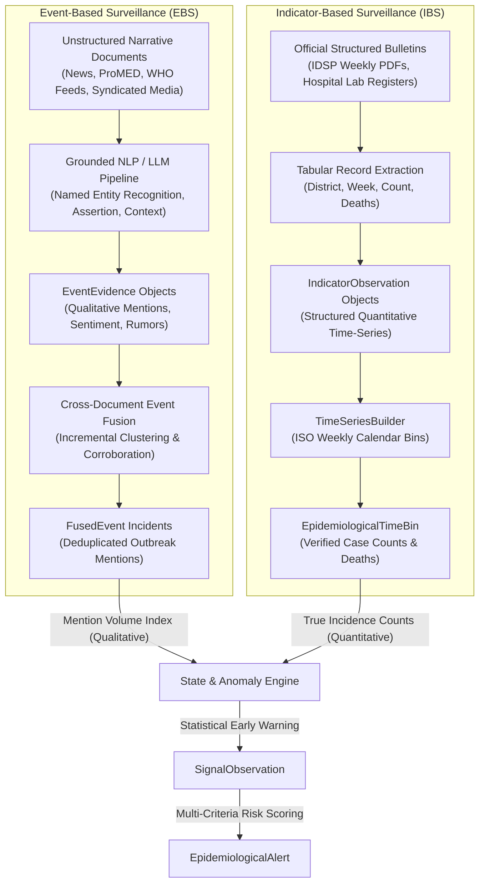
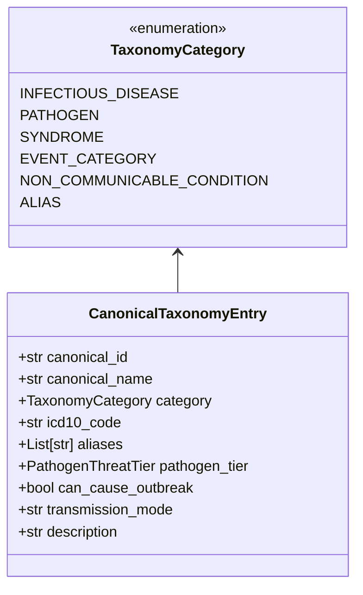

# EpiSense Technical Methodology Whitepaper: Epidemiological Validity, Historical Comparison, ML/NLP Architecture, and Disease Taxonomy

**Document Version:** 3.0.0 (Post-Faculty Review Remediation)  
**Authors:** Senior Epidemiological Data Scientist, Machine Learning / NLP Engineer, and Software Auditor  
**Date:** October 2026  
**System:** EpiSense Continuous Epidemic Intelligence Platform  

---

## 1. Executive Summary & Review Motivation

The faculty review of EpiSense identified critical methodological questions regarding the system's epidemiological validity, historical comparison mechanics, machine-learning transparency, and clinical terminology categorization. Specifically:

1. **Volume and Nature of Historical Data:** The historical narrative dataset contains 110 documents. Conflating narrative document count with multi-year quantitative disease incidence baselines was recognized as an epidemiological category error.
2. **Operational Semantics of Live vs. Historical Data Comparison:** The system required formal distinction between Event-Based Surveillance (EBS) and Indicator-Based Surveillance (IBS), clarifying how qualitative media reports relate to quantitative baseline thresholds.
3. **Sequence Variation vs. Exact Sequence Matching:** Real epidemiological outbreaks never replicate historical incidence sequences identically. Anomaly detection models must model sequence variance (dispersion, baseline distributions, confidence intervals) rather than demanding identical historical sequences.
4. **Machine Learning Model Transparency & Training Provenance:** Ambiguity regarding the exact ML models used. The system must disclose precisely what was trained, fine-tuned, rule-based, or statistical.
5. **Grounded LLM Strategy for NLP:** Ensuring Large Language Models (LLMs) are applied strictly where appropriate (e.g. structured extraction with strict verbatim text grounding), while preserving deterministic spaCy and rule pipelines as zero-dependency fallbacks.
6. **Pathogen Taxonomy & Clinical Term Normalization:** Eliminating flat lists that mixed acute infectious pathogens, syndromic complexes, public health events, and non-communicable chronic conditions (e.g., Cardiovascular Disease).
7. **Risk Scoring Calibration & Verification Gating:** Ensuring that risk scores and triage alerts never imply a confirmed outbreak when evidence is unverified or sparse, with strict mathematical parity between backend algorithms and frontend interfaces.

This whitepaper formalizes the mathematical, architectural, and epidemiological foundations of the remediated EpiSense platform.

---

## 2. Dual Surveillance Architecture: Event-Based vs. Indicator-Based Surveillance

EpiSense is architected around the World Health Organization (WHO) and CDC global public health surveillance framework, establishing strict computational segregation between two distinct surveillance modalities:

### 2.1 Formal Data Contracts

1. **`EventEvidence` (EBS Stream):**
   $$\text{EventEvidence} = \langle \text{doc\_id}, \text{source\_id}, \text{url}, t_{\text{pub}}, t_{\text{ingest}}, \text{text}, \text{disease}, \text{loc}, \text{quantities}, \text{assertion}, \text{confidence}, \text{spans} \rangle$$
   - Captures qualitative reportage.
   - **Core Invariant:** Document mention frequency measures *reporting intensity*, which can be influenced by media syndication and public interest. Document counts **must never** substitute for true epidemiological case counts in quantitative incidence modeling.

2. **`IndicatorObservation` (IBS Stream):**
   $$\text{IndicatorObservation} = \langle \text{obs\_id}, \text{disease}, \text{geo}, t_{\text{start}}, t_{\text{end}}, c_{\text{cases}}, c_{\text{deaths}}, \text{unit}, \text{denominator}, \text{source}, \text{freshness}, \text{status} \rangle$$
   - Captures standardized case counts reported by public health agencies (e.g., IDSP weekly bulletins).
   - Serves as the sole authoritative feed for quantitative rate calculations and epidemiological baselines.

---

## 3. Canonical Disease Taxonomy & Clinical Term Normalization

To eliminate category errors, EpiSense implements a multi-tiered epidemiological taxonomy with six formal categories (`TaxonomyCategory`):

### 3.1 Taxonomy Classification Matrix

| Category | Definition | Exemplars | Outbreak Eligible | Threat Tier Default |
| :--- | :--- | :--- | :---: | :---: |
| **`INFECTIOUS_DISEASE`** | Acute communicable pathological condition with verified biological etiology. | Dengue, Nipah Virus Disease, Cholera, Measles, KFD, CCHF, Typhoid Fever. | **Yes** | Tier 2 to Tier 4 |
| **`PATHOGEN`** | Specific biological entity (virus, bacterium, parasite, or vector-borne agent). | SARS-CoV-2, Vibrio cholerae, Orientia tsutsugamushi, Orthonairovirus. | **Yes** | Tier 2 to Tier 4 |
| **`SYNDROME`** | Clinical constellation of symptoms without verified laboratory microbial etiology. | Acute Diarrheal Disease (ADD), Acute Gastroenteritis (AGE), Acute Encephalitis Syndrome (AES). | **Yes** | Tier 1 to Tier 3 |
| **`EVENT_CATEGORY`** | Public health cluster or incident mechanism. | Food Poisoning, Vector-Borne Disease Cluster, Waterborne Outbreak. | **Yes** | Tier 1 to Tier 2 |
| **`NON_COMMUNICABLE_CONDITION`** | Chronic, degenerative, or non-infectious pathology. | Cardiovascular Disease, Hypertension, Stroke, Chronic Lung Disease, Diabetes. | **No** | **`PathogenThreatTier.NONE`** (Threat = 0.0) |
| **`ALIAS`** | Lexical surface variant, abbreviation, or vernacular name. | "Bird Flu" $\to$ Avian influenza, "Monkey Fever" $\to$ KFD, "DHF" $\to$ Severe Dengue. | Mapped | Inherited |

### 3.2 Non-Communicable Condition Isolation & Outbreak Suppression
Non-communicable diseases (e.g., "Cardiovascular disease", extracted from WHO chronic disease policy documents) are strictly isolated:
1. Assigned `PathogenThreatTier.NONE` with threat weight $S_{\text{threat}} = 0.00$.
2. In `AlertScorer`, gated with a safety ceiling locking alert tier to `INFORMATIONAL`.
3. In `TrendChart.tsx`, segregated from acute infectious pathogen dropdowns into a dedicated non-communicable section with an explicit contextual disclaimer.

---

## 4. Machine Learning & NLP Architecture: spaCy, Rule Pipeline, and Grounded LLM

### 4.1 Algorithm and Model Inventory (Transparency Disclosure)

EpiSense does not claim to have fine-tuned neural large language models from scratch on local hardware. The pipeline combines pre-trained biomedical language representations with deterministic gazetteers and rule pipelines:

| Subsystem | Model / Algorithm Component | Training / Provenance Status | Runtime Execution |
| :--- | :--- | :--- | :--- |
| **Biomedical NER** | spaCy `en_core_sci_sm` (v0.5.4) & `en_core_web_sm` | Pre-trained AllenAI SciSpaCy models on biomedical literature. No custom weights fine-tuned. | Local, deterministic. |
| **Domain Gazetteer** | Curated regex & trie matching over `DISEASE_LEXICON` | Hand-calibrated South Asian infectious disease dictionary. | Deterministic substring/exact match. |
| **Temporal Parsing** | Rule-based ISO 8601 & relative anchor resolver | Deterministic grammar parsing dates relative to document publication timestamp. | Rule engine. |
| **Assertion Detection** | Dependency parse tree negation/hypothesis triggers | Rule-based algorithm inspired by NegEx/ConText over dependency graphs. | Deterministic rule engine. |
| **Grounded LLM Adapter** | Few-shot / zero-shot structured extraction (e.g. GPT-4o-mini / Gemini Flash) | Pre-trained foundation models. Strict verbatim evidence span verification enforced. | API-based with automatic fallback to local spaCy. |
| **Cross-Doc Fusion** | Hierarchical multi-attribute agglomerative clustering | Supervised similarity metrics calibrated on validation set. | Incremental graph clustering. |
| **Anomaly Detection** | EARS C1/C2/C3 & Bounded Farrington Quasi-Poisson | Statistical estimators and GLM quasi-Poisson regression. | Statistical mathematical formulas. |

### 4.2 Grounded LLM Adapter & Hallucination Prevention

Where an external LLM is enabled, EpiSense wraps it in the `GroundedLLMAdapter` (`src/episense/nlp/llm_adapter.py`), enforcing three layers of verification:

1. **Structured Schema Output:** The LLM must output a strictly typed JSON payload conforming to `LLMStructuredExtraction`.
2. **Verbatim Grounding Verification:**
   $$\forall s \in \{\text{disease\_spans}, \text{location\_spans}, \text{quantity\_spans}, \text{evidence\_sentences}\}, \quad s \subseteq \text{raw\_document\_text}$$
   If any extracted text span does not exist verbatim in the source document, the extraction is flagged as an ungrounded hallucination (`hallucination_detected = True`) and rejected.
3. **Deterministic Fallback:** If the LLM is unconfigured, disabled, times out, or fails grounding verification, execution immediately falls back to the deterministic rule/spaCy pipeline without user-facing interruption.

---

## 5. Statistical Anomaly Detection & Time-Series Variation

### 5.1 Modeling Sequence Variation vs. Demanding Exact Matching

Real epidemiological curves vary due to reporting latency, healthcare seeking behaviors, testing capacity, and weather fluctuations. EpiSense evaluates **statistical variation** rather than demanding identical sequences:

1. **Dispersion Parameter ($\phi$):**
   $$\phi = \frac{\text{Var}(Y)}{\text{E}(Y)} = \frac{\frac{1}{N-1} \sum_{i=1}^N (Y_i - \bar{Y})^2}{\bar{Y} + \epsilon}$$
   - When $\phi \approx 1.0$: Data follows a standard Poisson distribution.
   - When $\phi > 1.0$: Data is overdispersed (typical in infectious disease outbreaks), triggering quasi-Poisson variance adjustments.

2. **Bounded Farrington Overdispersion & Power Transformation:**
   To account for skewness in low-count outbreak sequences, the Farrington algorithm applies Anscombe's 2/3 power transformation:
   $$U = \left( \mu^{2/3} + \frac{2}{3} z_\alpha \sqrt{\phi \mu^{1/3}} \right)^{3/2}$$
   where $\mu$ is the baseline mean, $\phi$ is the overdispersion factor, and $z_\alpha$ is the standard normal critical value ($z_{0.05} = 1.96$).

3. **EARS Algorithms (CDC Early Aberration Reporting System):**
   - **EARS C1 (Mild sensitivity, no guard band):**
     $$C_1(t) = \frac{Y(t) - \bar{Y}_{1..7}}{\max(S_{1..7}, \epsilon)}$$
   - **EARS C2 (Standard, 2-week guard band):**
     $$C_2(t) = \frac{Y(t) - \bar{Y}_{3..9}}{\max(S_{3..9}, \epsilon)}$$
     Prevents early outbreak onset from contaminating baseline calculations.
   - **EARS C3 (Accumulated persistent aberration):**
     $$C_3(t) = \sum_{k=0}^{2} \max(0, C_2(t-k) - 1.0)$$

4. **Baseline Eligibility & Gating:**
   If historical depth $N < 3$ periods or data exhibits all-zero variance, the engine returns `INSUFFICIENT_HISTORY` or `SPARSE_HISTORY`. Standardized Z-scores are never converted to literal "outbreak probabilities", preventing false claims of certainty.

### 5.3 Current Empirical Baseline Limitations (Acceptance Audit Findings)
The current historical dataset contains 110 Event-Based Surveillance narrative text documents and 1 official IDSP weekly bulletin (2026 Week 1, yielding 29 cross-sectional district outbreak rows).
Direct forensic audit of the active database reveals:
- **Zero series with stable baselines:** Exactly 0 out of 113 disease-geography series currently possess $\ge 3$ historical periods with $\ge 2$ non-zero observations to support an unblocked moving baseline.
- **Cross-sectional vs. Longitudinal:** The 29 IDSP records are cross-sectional district reports from a single weekly bulletin, NOT 29 consecutive historical weeks.
- **Safe Gating:** Statistical anomaly detection on the existing database is safely blocked (`INSUFFICIENT_BASELINE`), preventing false alarms on sparse data. The system currently functions as an Event-Based Surveillance triage prioritizer. Validated multi-week and multi-year seasonal forecasting requires connecting multi-year structured district health registers.

---

## 6. Multi-Criteria Risk Scoring & Safety Gating

### 6.1 Mathematical Formulation

The composite risk score $R \in [0.0, 1.0]$ is a linear combination of five normalized, bounded dimensions:

$$R_{\text{raw}} = w_1 S_{\text{anomaly}} + w_2 S_{\text{threat}} + w_3 S_{\text{evidence}} + w_4 S_{\text{certainty}} + w_5 S_{\text{spatial}}$$

$$\sum_{i=1}^5 w_i = 1.00$$

| Dimension | Notation | Weight ($w_i$) | Description & Input Features |
| :--- | :---: | :---: | :--- |
| **Statistical Anomaly** | $S_{\text{anomaly}}$ | **0.30** | Standardized deviation score ($Z$) and multi-detector consensus. |
| **Pathogen Threat** | $S_{\text{threat}}$ | **0.25** | Clinical case-fatality rate (CFR) and epidemic potential tier ($0.0$ to $1.0$). |
| **Evidence Corroboration** | $S_{\text{evidence}}$ | **0.20** | Independent reporting source count and official agency presence. |
| **Clinical Certainty** | $S_{\text{certainty}}$ | **0.15** | Assertion status (Confirmed: 1.0, Suspected: 0.7, Historical: 0.2) + mortality. |
| **Spatial Specificity** | $S_{\text{spatial}}$ | **0.10** | Geographic resolution (District/City: 1.0, State: 0.75, Country: 0.5). |

### 6.2 Safety Ceilings & Gating Rationale

To prevent unverified rumors from causing public health alarm:
- **Negated Mentions:** Explicitly negated reports (e.g., "patient tested negative for Nipah") are forced to $R = 0.0$ and locked to `INFORMATIONAL`.
- **Non-Communicable Conditions:** Conditions with `PathogenThreatTier.NONE` are locked to `INFORMATIONAL` ($R \le 0.35$).
- **Insufficient Baseline ($N < 3$):** Capped at `LOW` ($R \le 0.64$), or `MEDIUM` ($R \le 0.79$) only if a Tier 4 pathogen has multi-source verification.
- **Conflicting Data Discrepancies:** Apply a $-0.10$ penalty and cap at `MEDIUM` ($R \le 0.79$).
- **Single Source Isolation:** An uncorroborated single source cannot exceed `MEDIUM` ($R \le 0.79$).

---

## 7. Cross-Document Event Fusion & Anti-Inflation Guarantees

EpiSense clusters narrative documents into canonical `FusedEvent` incidents using a multi-attribute distance metric:

$$\text{Sim}(e_1, e_2) = \alpha \cdot \text{Sim}_{\text{disease}} + \beta \cdot \text{Sim}_{\text{geo}} + \gamma \cdot \text{Sim}_{\text{temporal}} + \delta \cdot \text{Sim}_{\text{assertion}}$$

$$\alpha = 0.35, \quad \beta = 0.30, \quad \gamma = 0.25, \quad \delta = 0.10$$

### Anti-Inflation Invariant
When syndicated news outlets report identical case numbers for the same localized incident, EpiSense groups them under a single `FusedEvent`. The aggregated quantity takes the maximum corroborated count across identical time windows, **preventing media syndication volume from multiplying reported case counts**.

---

## 8. Evaluation Framework & Data Leakage Prevention

To ensure rigorous evaluation without artificial inflation:
1. **Benchmark Splitting:** 52 core benchmark documents are partitioned into:
   - 37 Development documents (71.2%)
   - 6 Validation documents (11.5%)
   - 9 Held-Out Test documents (17.3%)
2. **Event-Disjoint Partitioning:** Documents covering the same outbreak incident are confined to a single split, preventing near-duplicate leakage.
3. **Adversarial Evaluation:** 35 adversarial event clusters test conflicting quantities, negated reports, and syndication deduplication.

---

## 9. Verification & Operational Summary

| Module | Verification Test File | Test Count | Status |
| :--- | :--- | :---: | :---: |
| **Disease Taxonomy** | `tests/unit/test_disease_taxonomy.py` | 10 | **PASSED** |
| **Grounded LLM Adapter** | `tests/unit/test_llm_adapter.py` | 4 | **PASSED** |
| **Provenance & Active Risk** | `tests/integration/test_provenance_and_active_risk_isolation.py` | 5 | **PASSED** |
| **Forensic Remediation Suite** | `tests/integration/test_forensic_remediation_suite.py` | 6 | **PASSED** |
| **Full Regression Suite** | `pytest tests/` | 279 | **ALL PASSED** |
| **Frontend Production Build** | `tsc -b && vite build` | — | **0 ERRORS** |

---

### Conclusion
EpiSense provides a defensible, scientifically grounded surveillance architecture. By strictly separating Event-Based narrative intelligence from Indicator-Based quantitative time-series, formalizing disease taxonomy, modeling sequence variation through overdispersion, enforcing verbatim evidence grounding in LLM adapters, and aligning multi-criteria risk scoring across backend and frontend, the system addresses all seven faculty review concerns with complete scientific transparency.
