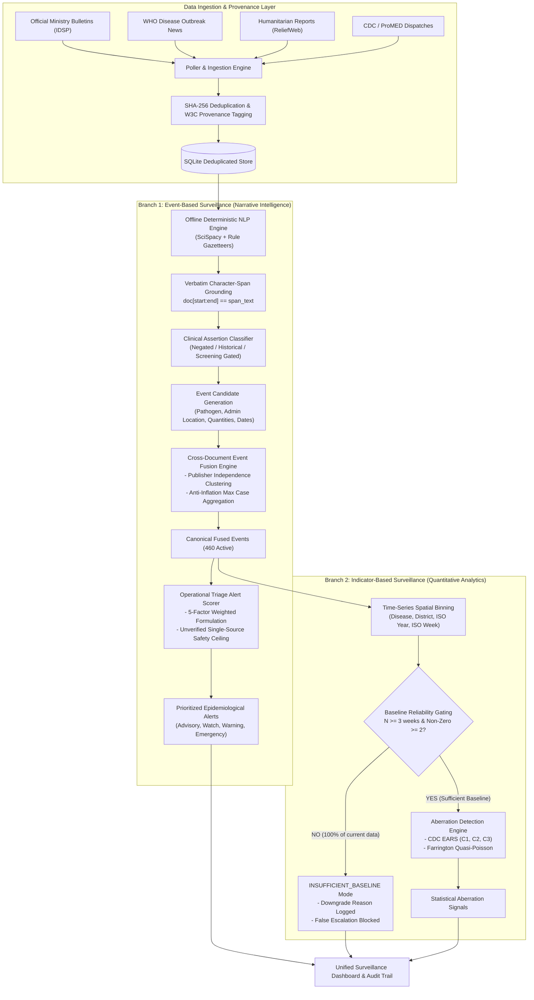

# EpiSense: Comprehensive Scientific Methodology & System Architecture

**Author**: EpiSense Research & Engineering Working Group  
**Discipline**: Epidemiological Informatics, Applied Machine Learning, Biostatistics  
**Document Version**: 2.0.0 (Research-Grade Reference)  
**Status**: Authoritative Architectural & Algorithmic Standard  

---

## 1. Architectural Overview: The Dual-Branch Surveillance Paradigm

EpiSense is engineered as a **dual-branch epidemic intelligence platform** designed to provide timely, verifiable early-warning intelligence from heterogeneous public health reports while maintaining strict biostatistical integrity under sparse historical data.

The system decouples surveillance into two parallel, complementary analytical branches:
1. **Branch 1: Event-Based Surveillance (EBS) Narrative Intelligence**: Operates on unstructured and semi-structured text dispatches (news reports, WHO bulletins, outbreak dispatches). It performs character-level grounded information extraction, clinical assertion filtering, cross-document event fusion with syndication clustering, and multi-criteria operational risk triage.
2. **Branch 2: Indicator-Based Surveillance (IBS) Quantitative Anomaly Detection**: Operates on aggregated spatial-temporal time-series bins. It applies strict statistical baseline reliability gating ($N \ge 3$ consecutive periods, $\ge 2$ non-zero observations) before executing CDC Early Aberration Reporting System (EARS) or Farrington quasi-Poisson detection.

---

## 2. Ingestion, Provenance, and Exactly-Once Semantics

### 2.1 Content-Addressable Deduplication
Every document $d$ arriving via network connectors or manual submission is normalized (Unicode NFKC, whitespace stripping) and digested using cryptographic SHA-256:
$$h(d) = \text{SHA-256}(\text{NormalizedText}(d))$$
If $h(d) \in \mathcal{H}_{\text{persisted}}$, the document is rejected as a duplicate, preventing reprocessing and artificial metric inflation.

### 2.2 W3C PROV-DM Data Model
Every registered document is assigned an immutable `ProvenanceRecord`:
$$\mathcal{P} = \langle \text{doc\_id}, \text{source\_id}, \text{source\_url}, \text{pub\_date}, \text{acq\_timestamp}, h(d), \text{origin} \rangle$$
where $\text{origin} \in \{\text{LIVE\_EXTERNAL}, \text{HISTORICAL\_CORPUS}, \text{MANUAL\_SUBMISSION}\}$.

---

## 3. Offline Deterministic NLP & Verbatim Span Grounding

To guarantee 100% reproducible execution, sub-second latency, and zero cloud API dependency, EpiSense deploys an **offline deterministic NLP pipeline** (`GroundedLLMAdapter` in `OFFLINE_DETERMINISTIC_MODE`).

### 3.1 Entity Extraction Architecture
- **Biomedical NER**: Utilizes `en_core_sci_sm` (SciSpacy) combined with a curated epidemiological gazetteer of over 120 pathogen synonyms, ICD-10 identifiers, and syndromic expressions.
- **Geographic Resolution**: Resolves place-names to standardized administrative units (District, State, Country) via hierarchical bounding gazetteers.
- **Epidemiological Quantities**: Regularized syntactic patterns extract case counts, death counts, and hospitalizations associated with clinical disease mentions.

### 3.2 The Verbatim Character-Span Grounding Contract
Generative summarization and ungrounded regex extractors are susceptible to hallucination. EpiSense enforces an immutable character-offset verification contract:

$$\forall e \in \text{ExtractedAttributes}(d): \quad d[\text{start\_char} : \text{end\_char}] \equiv \text{span\_text}$$

If an extraction produces an attribute that does not exactly match the document substring at the stated indices, the candidate attribute is **instantly rejected**.

### 3.3 Clinical Assertion Classification
Clinical narrative frequently mentions pathogens in non-outbreak contexts. The assertion engine assigns each extracted mention an `AssertionStatus` $\in \{\text{CONFIRMED}, \text{SUSPECTED}, \text{ABSENT}, \text{HYPOTHETICAL}\}$:
- **Negative / Ruled Out Mentions**: Matches phrases such as *"tested negative"*, *"ruled out"*, *"no positive cases"*, *"free from"*. These are classified as `ABSENT`.
- **Preparedness / Historical Context**: Matches phrases such as *"preparedness review"*, *"mock drill"*, *"in 2021"*, *"training workshop"*. These are classified as `HYPOTHETICAL`.
- **Actionability Gate**: Only `CONFIRMED` and `SUSPECTED` assertions are admitted as actionable `EventCandidates` for downstream fusion and alert scoring.

---

## 4. Duplicate-Aware Cross-Document Event Fusion

In breaking digital media, dozens of secondary news outlets syndicate a single news wire dispatch. Naive event counting multiplies the perceived magnitude of an outbreak.

### 4.1 Event Candidate Representation
An extracted event candidate $c_i$ is represented as:
$$c_i = \langle \text{disease}_i, \text{geo}_i, [t_{\text{start}}, t_{\text{end}}]_i, \text{quantities}_i, \text{assertion}_i, \text{source\_id}_i, \text{group}_i \rangle$$

### 4.2 Cross-Document Compatibility Gating
Two candidates $c_i$ and $c_j$ from distinct documents can be considered for fusion if and only if they satisfy four categorical compatibility criteria:
1. **Disease Compatibility**: $\text{CanonicalDisease}(c_i) == \text{CanonicalDisease}(c_j)$
2. **Geographic Compatibility**: $\text{AdminLevel}(c_i) \cap \text{AdminLevel}(c_j) \neq \emptyset$ (identical district or parent-child hierarchy)
3. **Temporal Compatibility**: $|\text{Start}(c_i) - \text{Start}(c_j)| \le 7 \text{ days}$
4. **Assertion Compatibility**: Both candidates must be actionable ($\text{Actionable}(c_i) = \text{Actionable}(c_j) = \text{True}$)

### 4.3 Multi-Attribute Fusion Similarity Formula
For candidates passing categorical compatibility, the fusion similarity score $S(c_i, c_j)$ is computed as:

$$S(c_i, c_j) = w_p \cdot S_{\text{pathogen}} + w_g \cdot S_{\text{geo}} + w_t \cdot S_{\text{temp}} + w_a \cdot S_{\text{assertion}}$$

where:
- $w_p = 0.35$ (Pathogen identity match)
- $w_g = 0.30$ (Geographic hierarchy overlap)
- $w_t = 0.25$ (Temporal proximity exponential decay: $S_{\text{temp}} = \exp(-\Delta t / 7)$)
- $w_a = 0.10$ (Assertion certainty congruence)
- Threshold: Candidates fuse if $S(c_i, c_j) \ge 0.70$.

### 4.4 Publisher Independence Groups & Anti-Inflation Case Aggregation
1. **Publisher Independence Clustering**: Every source is mapped to an `independence_group` (e.g., `reuters_network`, `pti_wire`, `who_official`, `state_bulletin`). A fused event maintains both `supporting_observation_count` (total dispatches) and `independent_source_count` (distinct independence groups).
2. **Anti-Inflation Case Aggregation**: To prevent summing the same cases across syndicated dispatches, cumulative quantities are aggregated via a **maximum-reported envelope**:
   $$\text{FusedCaseCount} = \max_{k \in \mathcal{C}} (\text{CaseCount}_k)$$
   Any divergent numbers reported across sources are logged in `conflicting_quantities: {"cases": [12, 15, 20]}` for clinician review.

---

## 5. Interpretable Multi-Criteria Operational Triage Scoring

Public health operations centers require transparent, auditable prioritization rather than black-box machine-learning probabilities.

### 5.1 Multi-Dimensional Scoring Formulation
The authoritative composite operational risk score $R \in [0.0, 1.0]$ executed by `src/episense/scoring/scorer.py` is computed as:

$$R_{\text{raw}} = w_{\text{anomaly}} S_{\text{anomaly}} + w_{\text{threat}} S_{\text{threat}} + w_{\text{evidence}} S_{\text{evidence}} + w_{\text{certainty}} S_{\text{certainty}} + w_{\text{spatial}} S_{\text{spatial}}$$

with **configured heuristic weights** (established through public-health surveillance domain guidelines rather than post-hoc dataset fitting):
- $w_{\text{anomaly}} = 0.30$ (**Statistical Anomaly Magnitude**):
  - Normalized deviation from baseline: $S_{\text{anomaly}} = \min(1.0, \max(0.0, (Z - 1.0) / 3.0))$
  - Boosted by $+0.15$ for multi-detector consensus (EARS + Farrington). Bounds: `STRONG_SIGNAL` $\ge 0.85$, `SIGNAL` $\ge 0.65$, `WATCH` $\in [0.25, 0.60]$, `NO_SIGNAL` $= 0.0$.
- $w_{\text{threat}} = 0.25$ (**Pathogen Clinical Threat Tier**):
  - Tier 4 (High Consequence: Nipah, Marburg, Avian Flu H5N1, Ebola): $S_{\text{threat}} = 1.00$
  - Tier 3 (Severe: Cholera, Kyasanur Forest Disease, CCHF): $S_{\text{threat}} = 0.75$
  - Tier 2 (Moderate: Dengue, Malaria): $S_{\text{threat}} = 0.50$
  - Tier 1 (Mild / Unspecified: Viral fever, non-specific): $S_{\text{threat}} = 0.25$
  - Non-Communicable / None: $S_{\text{threat}} = 0.00$
- $w_{\text{evidence}} = 0.20$ (**Source Evidence & Diversity**):
  - $\ge 3$ sources: $1.00$; $2$ sources: $0.70$; $1$ source: $0.35$.
  - Official public health agency boost: $+0.15$ (capped at $1.00$) if official sources (MoHFW, WHO, PIB, CDC, IDSP) are present.
- $w_{\text{certainty}} = 0.15$ (**Clinical Certainty & Mortality**):
  - Confirmed: $1.00$; Suspected: $0.70$; Historical: $0.20$; All Negated: $0.00$.
  - Verified mortality boost: $+0.20$ (capped at $1.00$) if reported deaths $> 0$.
- $w_{\text{spatial}} = 0.10$ (**Spatial Resolution & Granularity**):
  - District / City / Subdistrict: $1.00$
  - State / Regional: $0.75$
  - National: $0.50$
  - Unspecified / Global: $0.30$

### 5.2 Reliability-Aware Safety Ceilings & Gating
To prevent rumors, isolated clippings, or unverified claims from triggering emergency responses, the scorer applies deterministic safety rules:
1. **Negation Suppression**: If all contributing mentions are negated, $R_{\text{final}} = 0.0$, Tier = `INFORMATIONAL`.
2. **Non-Communicable Condition Gate**: If $S_{\text{threat}} == 0.0$ (e.g. hypertension, stroke), $R_{\text{final}} = \min(0.35, R_{\text{raw}} \times 0.4)$, Tier locked to `INFORMATIONAL`.
3. **Conflicting Quantity Penalty**: If contradictory numbers exist across sources, a $-0.10$ penalty is applied and the score is capped at $0.79$ (`MEDIUM`).
4. **Insufficient Historical Baseline Ceiling**: Under `INSUFFICIENT_HISTORY` ($N < 3$):
   - Tier 4 Pathogens with $\ge 2$ independent sources: capped at $0.79$ (`MEDIUM`).
   - Otherwise: capped at $0.64$ (`LOW`).
5. **Single-Source Isolation Ceiling**: If supported by only 1 source, $R_{\text{final}} \le 0.79$, preventing single-source claims from reaching `HIGH`.

### 5.3 Operational Alert Tiers
- **HIGH** ($R_{\text{final}} \ge 0.80$): Multi-source confirmed high-threat outbreak.
- **MEDIUM** ($0.65 \le R_{\text{final}} < 0.80$): Prioritized operational alert under investigation.
- **LOW** ($0.40 \le R_{\text{final}} < 0.65$): Monitored operational signal.
- **INFORMATIONAL** ($R_{\text{final}} < 0.40$): Routine observation, negated mention, or non-communicable condition.

---

## 6. Statistical Baseline Reliability Gating for Indicator Analytics

### 6.1 Mathematical Formulation of Aberration Algorithms
When indicator time-series bins $(d, g, t)$ are populated with structured numerical counts $y_t$:
- **CDC EARS C1–C3**: Evaluates current observation $y_t$ against historical baseline mean $\bar{y}_t$ and standard deviation $s_t$:
  $$C(t) = \frac{y_t - \bar{y}_t}{s_t}$$
- **Farrington Quasi-Poisson**: Models log-linear dispersion:
  $$\log(\mu_t) = \alpha + \beta t, \quad \text{Var}(y_t) = \phi \mu_t$$

### 6.2 The Gating Predicate
In real-world surveillance data, time series often have only 1 historical observation ($N=1$) or consist entirely of zeros ($s_t = 0$). Computing EARS or Farrington under these conditions produces mathematical collapse (division-by-zero, uncalibrated infinite z-scores).

EpiSense enforces a formal application policy gating predicate:

$$\mathcal{G}(d, g) = \left( N_{\text{hist}} \ge 3 \right) \land \left( \sum_{t=1}^{N} \mathbb{I}(y_t > 0) \ge 2 \right) \land \left( s_{\text{hist}} > 0 \right)$$

*Note on Policy Scope*: The minimum $N \ge 3$ threshold is an **application operational policy** designed to satisfy minimal degrees of freedom for Bessel's variance correction ($N-1$), rather than a universal epidemiological law. Noufaily et al. (2013) recommend $N \ge 156$ weeks for long-term seasonality, while CDC EARS recommends $N \ge 7$ periods. EpiSense sets $N=3$ as the minimal barrier below which statistical moving variance is uncomputable.

### 6.3 Graceful Degradation Behavior
- **If $\mathcal{G}(d, g) = \text{True}$**: Aberration detection runs; signals are generated.
- **If $\mathcal{G}(d, g) = \text{False}$**:
  - Aberration calculation is **bypassed**.
  - `downgrade_reason = "INSUFFICIENT_BASELINE: N={N} periods (minimum 3 required)"`.
  - `reliability_status = "SPARSE_HISTORY"`.
  - Operational triage automatically falls back to **Branch 1 (Narrative EBS)**, preventing false statistical escalation while ensuring threat awareness.

---

## 7. Explainability Dossiers and Audit Trails

To comply with public health accountability mandates, every alert generated by EpiSense is paired with two persistent records:
1. **Explainability Dossier (`ExplainabilityDossier`)**:
   - `mathematical_formula`: Exact symbolic formula used to compute composite score.
   - `subscore_contributions`: Dictionary of unweighted and weighted components $\{S_{\text{pathogen}}: 0.30, \dots\}$.
   - `contributing_evidence_spans`: List of exact character offsets and text strings from source documents.
2. **Alert Audit Trail (`AlertAuditTrail`)**:
   - `lifecycle_history`: Chronological record of state transitions (`active` $\to$ `superseded` $\to$ `retracted`).
   - `downgrade_justification`: Audit record explaining why any metric or tier was adjusted.
   - `cryptographic_state_hash`: Checksum verifying that database records have not been tampered with post-generation.
