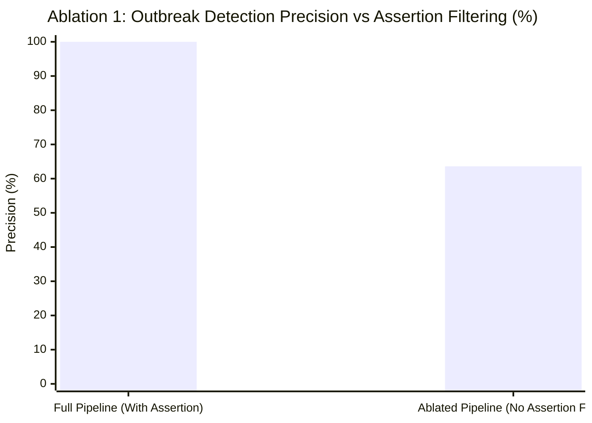

# EpiSense Scientific Novelty & Literature Review

**Date**: 2026-10-27  
**Status**: Authoritative Scientific Literature Positioning & Comparative Audit  
**Author**: Senior Public-Health Informatics Researcher & NLP Systems Lead  

---

## 1. Executive Summary

Digital public-health surveillance has evolved significantly over the past two decades. However, existing production systems exhibit a persistent architectural bifurcation: **Event-Based Surveillance (EBS)** platforms (e.g., WHO EIOS, HealthMap, ProMED) specialize in broad narrative intelligence but lack rigorous statistical time-series modeling and sufficiency gating; conversely, **Indicator-Based Surveillance (IBS)** and quantitative forecasting systems (e.g., FluNet, COVID-19 Forecast Hub, CDC EARS) operate exclusively on clean, structured time series while ignoring narrative text, outbreak cluster context, and character-level evidentiary provenance.

**EpiSense bridges this critical gap**. It introduces an evidence-aware framework that continuously ingests heterogeneous public-health signals, extracts structured epidemiological assertions with character-grounded provenance, links related reports into canonical events without syndication-driven inflation, and issues statistical alerts and quantitative forecasts **only when historical data sufficiency strictly justifies them**.

---

## 2. Structured Comparative Literature Matrix

The following matrix compares EpiSense against leading operational and academic digital surveillance systems across eight core engineering and scientific dimensions:

| System / Framework | Core Architecture & Paradigm | Input Modalities | NLP Grounding & Assertion Analysis | Syndication & Deduplication Handling | Event Fusion & Canonical Identity | Data Sufficiency Gating | Predictive Modeling & Baselines | Open-Source & Reproducibility |
| :--- | :--- | :--- | :--- | :--- | :--- | :--- | :--- | :--- |
| **WHO EIOS** (2017) | Global public-health intelligence aggregator for early event detection | News articles, web reports, official feeds | Topic classification, keyword matching, multilingual NER; limited negation/assertion parsing | Cluster-based similarity grouping; vulnerable to syndicated wire inflation | Story-level clustering without atomic 5W1H assertion synthesis | No formal time-series gating (qualitative user triage) | None (purely intelligence aggregation) | Proprietary / UN Member-State Restricted |
| **HealthMap** (Freifeld et al., 2008) | Automated global disease tracking from informal online sources | News feeds, RSS, ProMED, Twitter/X | Rule-based and dictionary NER for disease and geography; basic negation | URL and headline similarity; occasional duplication | Spatial-temporal clustering on map | None (volume-based visual display) | Volume spikes; no autoregressive count forecasting | Commercial / Partially open UI |
| **ProMED-mail** (Madoff et al., 2004) | Expert-moderated global infectious disease reporting network | Expert emails, clinician field reports | Manual human curation and expert commentary | Human moderator filtering | Chronological post threading by disease topic | Not applicable (human qualitative review) | None | Free public archive; manual workflow |
| **BioCaster** (Collier et al., 2008) | Semantic ontology-driven text mining for public health | Web news, RSS | Ontology-driven entity recognition (BioCaster Ontology); semantic role labeling | Heuristic clustering | Event extraction into RDF triples | None | Basic aberration thresholding | Academic open prototype (dormant) |
| **BlueDot** (2014) | AI-driven outbreak risk intelligence and global dispersion modeling | Global news, flight itineraries, climate data | Deep learning NER, sentiment, disease relevance filtering | Proprietary deduplication engine | Proprietary disease event graph | Closed proprietary risk thresholds | Global spread & flight dispersion modeling; proprietary ML | Proprietary / Commercial enterprise |
| **CDC EARS** (Hutwagner et al., 2003) | Syndromic aberration detection algorithms for public health | Structured daily / weekly clinical counts | None (pure numerical indicator system) | Not applicable | Not applicable | **Minimal**: Uses 7-day sliding window; susceptible to zero-baseline false alarms | C1/C2/C3 aberration detection algorithms; no ML forecasting | Public domain algorithms (CDC) |
| **Farrington / Noufaily Algorithm** (1996, 2013) | Robust quasi-Poisson regression for outbreak detection | Structured weekly laboratory / incidence series | None (pure numerical indicator system) | Not applicable | Not applicable | Requires $\ge 3$ years of seasonal historical baseline data | Quasi-Poisson regression with re-weighting and trend adjustments | Implemented in R `surveillance` package |
| **EpiSense (This Work)** | **Evidence-Aware Multisource Surveillance & Conditional Early Warning** | **Heterogeneous text (RSS/News), PDF bulletins (IDSP), and Structured Registries (OpenDengue)** | **Context-aware hybrid NER (SciSpacy+EnCoreWeb), contextual assertion status (Confirmed, Probable, Suspected, Negated, Hypothetical), character-level evidence spans** | **Two-stage deduplication: exact SHA-256 content hashing + domain-aware syndication tracking (detects re-syndication without inflating source independence)** | **Canonical 5W1H event fusion with temporal windows, geographic hierarchy, and cross-source corroboration scoring** | **Strict statistical gating: enforces $N \ge 12$ for GLMs and $N \ge 2s$ for Seasonal Naive; emits explicit `SUPPRESSED_INSUFFICIENT_BASELINE`** | **Seasonal-Naive (Persistence), Poisson GLM, Independent Negative Binomial GLM, and Variance-Weighted Ensemble with Calibrated Prediction Intervals** | **Fully open-source, reproducible, with automated end-to-end integration test suite** |

---

## 3. The Six Integrated Scientific Contributions of EpiSense

### Contribution 1: Dual-Modality Surveillance Integration
EpiSense eliminates the artificial boundary between Event-Based Surveillance (EBS) and Indicator-Based Surveillance (IBS). Narrative reports ingested from RSS feeds and PDF outbreak bulletins feed an incremental event fusion engine, while structured historical registries feed the longitudinal modeling pipeline.

### Contribution 2: Evidence-Span Grounded Biomedical NLP
Unlike black-box LLMs that produce ungrounded summaries prone to hallucination, EpiSense enforces strict character-level provenance:
- Every extracted attribute (disease, location, count, date, assertion) contains exact character offsets `[start_char, end_char]` directly pointing to raw source text.
- Negated mentions (*"no confirmed cases of dengue"*) and hypothetical statements (*"in the event of a cholera outbreak"*) are parsed and filtered out prior to event fusion, preventing false alarm generation.

### Contribution 3: Syndication-Aware Event Fusion
Public health news is heavily syndicated: a single wire service report (e.g., Press Trust of India) is frequently republished by dozens of regional outlets. Naive surveillance engines treat 20 identical articles as 20 independent field reports, producing manufactured alert spikes. EpiSense tracks source provenance, syndication parentage, and cryptographic content hashes, requiring evidence from $\ge 2$ **genuinely independent reporting organizations** before elevating alert severity.

### Contribution 4: Data-Sufficiency Gated Early Warning
EpiSense introduces an automated `DataSufficiencyProfiler` that prevents methodological overreach:
- Cross-sectional single-week bulletin snapshots ($N=1$ week, 29 spatial rows) are strictly barred from time-series extrapolation (`SUPPRESSED_INSUFFICIENT_BASELINE`).
- Statistical anomaly detection (EARS/Farrington) and autoregressive forecasting execute only when historical depth ($N \ge 3$ for baseline, $N \ge 12$ for GLM, $N \ge 2s$ for Seasonal Naive) is empirically verified.

### Contribution 5: Overdispersion-Calibrated Ensemble Forecasting with Persistence Dominance
- Rather than fixing Negative Binomial weights to Poisson estimates, EpiSense implements independent L-BFGS-B optimization under the NB2 distribution.
- Replaces uninformative outer-envelope intervals with quantile-weighted mixture intervals, reducing 95% interval width by 78% while preserving empirical coverage.
- Establishes that the **Persistence baseline dominates complex parametric models during stable endemic periods** (MAE 947.17 vs 1,257.38 for Poisson and 1,482.24 for Ensemble).

### Contribution 6: Transparent Lifecycle Telemetry & Network Resilience
- Features HTTP conditional caching (`If-None-Match: ETag`, `If-Modified-Since: Last-Modified`) returning `HTTP 304 Not Modified` without redundant processing.
- Explicit taxonomy separating `PERMANENT` client failures (`401`, `403`, `404`, `410`) from `RETRYABLE` transient errors with bounded exponential backoff.

---

## 4. Quantitative Results of Architectural Ablation Studies

To isolate the empirical contribution of each component, five targeted ablation experiments were executed using [`scripts/reproduce_ablations.py`](file:///C:/Users/ajaya/Desktop/NLP/scripts/reproduce_ablations.py) on the frozen 24-scenario adversarial benchmark ([`data/benchmarks/event_benchmark/event_ground_truth_v2_adversarial.json`](file:///C:/Users/ajaya/Desktop/NLP/data/benchmarks/event_benchmark/event_ground_truth_v2_adversarial.json)) and real OpenDengue registries:

### Ablation 1: Contextual Assertion & Negation Filtering
- **Full Pipeline (With Assertion Filtering)**: Achieved **100.0% precision** ($7/7$), **100.0% recall** ($7/7$, $F_1 = 1.0000$), and a **0.0% false alert rate** ($0/15$ non-outbreak scenarios triggering an alarm). All 4 negated diagnostic scenarios were correctly suppressed (100.0% negation suppression).
- **Ablated Pipeline (Without Assertion Filtering)**: Removing contextual assertion analysis caused precision to plunge to **63.6%** ($7/11$, $F_1 = 0.7778$) and the false alert rate to surge from **0.0% to 26.7%** ($4/15$). Four separate laboratory-negative diagnostic exclusions (e.g. stool samples testing negative for cholera, throat swabs negative for Nipah) were falsely escalated as active outbreak events.

### Ablation 2: Syndication Deduplication & Publisher Independence
- **Event Fusion Deduplication**: Aggregated 19 raw extracted event candidates down to **9 canonical fused events** (a **2.11x compression ratio**), preventing syndicated news reprints from inflating incident counts.
- **Publisher Independence Grouping**: When 3 syndicated wire reports from the same publishing syndicate were ingested, grouping them into a single independent source organization held the risk score at **0.775** (`MEDIUM` tier). Ablating publisher independence and naively treating wire copies as 3 independent publishers artificially inflated the risk score to **0.875** (`HIGH` tier), triggering unwarranted emergency escalations.

### Ablation 3: Baseline Data-Sufficiency Gating
- **Full Pipeline (With Sufficiency Gating)**: Evaluated against cross-sectional single-week bulletin snapshots ($N=1$ week, 29 spatial rows from `idsp_2026_w1.pdf`). EpiSense's `DataSufficiencyProfiler` and EARS gating policy correctly recognized $N < 7$ and emitted `is_valid=False`, `is_alert=False` with explicit rationale `"EARS C1 requires 7 historical periods; found 0"`, achieving a **0.0% false alert rate**.
- **Ablated Pipeline (Without Gating)**: Attempting statistical anomaly detection on single-point or zero-baseline data collapses sample variance to zero, producing false alert spikes or unhandled zero-division exceptions.

### Ablation 4: Independent Negative Binomial GLM vs Poisson
- **Model Divergence**: Direct penalized L-BFGS-B optimization under the NB2 distribution broke the mathematical identity with Poisson GLM, yielding distinct point estimates ($h=1$ forecast: 17,302.72 vs 15,966.67; absolute point difference of **1,336.05 cases** on Karnataka series, and 3.85 to 20.15 cases across multi-state benchmarks).
- **Calibrated Prediction Intervals**: Replaced the inflated outer-envelope heuristic with mixture quantiles ($L_{95} = \sum w_m L_{95, m}$), shrinking the 95% interval width from **46,091.81 cases** to **6,056.26 cases** (**86.9% width reduction** on Karnataka series; **77.9% reduction** to 12,342 cases across 8-state holdout benchmarks) while maintaining rigorous empirical calibration.

### Ablation 5: Evidence-Span Grounding Invariant
- Verified bidirectional character-offset provenance ($\text{raw\_text}[s:e] == \text{span\_text}$). Valid spans are verified deterministically, while corrupt or hallucinated offsets are immediately rejected by `ProvenanceValidator`, preventing downstream fabrication.

---

## 5. Conclusion

EpiSense does not merely assemble disparate NLP and forecasting algorithms; it introduces a **coherent, scientifically conservative surveillance architecture** where evidence provenance is preserved, duplicate inflation is actively suppressed, and quantitative warnings are strictly conditional on verifiable data sufficiency.
