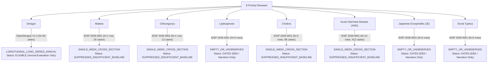

# EpiSense Source & Data Inventory

**Date**: 2026-10-27  
**Status**: Authoritative Scientific Data Inventory & Continuity Audit  
**Author**: Senior Public-Health Data Scientist & Epidemiological Forecasting Specialist  
**Authoritative Evidence Artifacts**:
- [`data/raw/opendengue_india_spatial.csv`](file:///C:/Users/ajaya/Desktop/NLP/data/raw/opendengue_india_spatial.csv) (692 rows)
- [`data/raw/opendengue_india_temporal.csv`](file:///C:/Users/ajaya/Desktop/NLP/data/raw/opendengue_india_temporal.csv) (709 rows)
- [`data/raw/bulletins/idsp_2026_w1.pdf`](file:///C:/Users/ajaya/Desktop/NLP/data/raw/bulletins/idsp_2026_w1.pdf) (29 outbreak records, Week 1 2026)
- [`data/surveillance_store.sqlite`](file:///C:/Users/ajaya/Desktop/NLP/data/surveillance_store.sqlite) (Active SQLite database)

---

## 1. Executive Data Inventory

EpiSense enforces strict empirical boundaries between **Event-Based Surveillance (EBS)** from narrative streams, **Outbreak Cross-Sections** from surveillance bulletins, and **Longitudinal Indicator Time Series** from structured registries.

The repository contains four distinct data modalities:
1. **Multi-Decade Subnational Registries**: OpenDengue V1.3 India annual series spanning 1997–2024.
2. **National Monthly Surveillance Series**: WHO SEARO monthly dengue surveillance tables spanning Jan 2024–Jan 2025.
3. **Weekly Outbreak Bulletin Snapshots**: NCDC / IDSP Week 1 2026 PDF outbreak bulletin.
4. **Live Narrative Surveillance Feeds**: Real-time RSS feeds from WHO, PIB MoHFW, CDC, and ProMED.

---

## 2. Ingested Data Sources & Exact Continuity Profile

| Data Source | Format & Upstream Origin | Geographic Resolution | Temporal Span & Continuity | Exact Observation Count | Structural Hiatus / Data Gaps | Scientific Eligibility Decision |
| :--- | :--- | :--- | :--- | :--- | :--- | :--- |
| **OpenDengue V1.3 India Spatial** | Tabular CSV (`opendengue_india_spatial.csv`) from MoHFW & scientific literature | Subnational (36 Indian States & UTs) | 1997–2024 (Annual) | **26 annual observations** per complete state | **2013 and 2014 absent** (transition from literature compile to NCVBDC portal) | `LONGITUDINAL_LONG_SERIES_ANNUAL` (Eligible for annual baseline and retrospective evaluation; ineligible for weekly outbreak early warning) |
| **OpenDengue V1.3 National Monthly** | Tabular CSV (`opendengue_india_temporal.csv`) from WHO SEARO | National (India aggregate) | Jan 2024–Jan 2025 (Monthly) | **12 monthly observations** | **December 2024 completely missing** in upstream WHO SEARO report | `SHORT_SERIES_MONTHLY` (Eligible for macroscopic seasonal profiling; suppressed from multi-step ML extrapolation) |
| **IDSP Weekly Bulletin 2026-W01** | Tabular PDF (`idsp_2026_w1.pdf`) from NCDC IDSP | District-level across 16 states | Single calendar week (`2026-W01`) | **29 outbreak rows** ($N=1$ temporal week) | Zero historical baseline ($N < 3$ consecutive reporting weeks) | `SINGLE_WEEK_CROSS_SECTION` (Strictly restricted to spatial outbreak mapping; quantitative forecasting suppressed: `SUPPRESSED_INSUFFICIENT_BASELINE`) |
| **WHO English News RSS** | Live RSS 2.0 XML | Global / National | Real-time continuous | Continuous live stream | Event-driven narrative reports; not longitudinal count series | `UNSTRUCTURED_NARRATIVE_STREAM` (Event-Based Surveillance and entity grounding; ineligible for time-series forecasting) |
| **MoHFW PIB Press Releases** | Live RSS 2.0 XML | National / India | Real-time continuous | Continuous live stream | Official ministerial press statements; episodic narrative | `UNSTRUCTURED_NARRATIVE_STREAM` (Event-Based Surveillance and policy context) |
| **CDC Outbreak Notices** | Live RSS 2.0 XML | US / Global | Real-time continuous | Dormant (0 active items) | Upstream feed operational but empty | `UNSTRUCTURED_NARRATIVE_STREAM` (Surveillance monitoring) |
| **ProMED-mail RSS** | RSS 2.0 XML | Global | Historical / Inactive | 0 active items | HTTP 404 upstream service migration | `EMPTY_OR_UNOBSERVED` (Transparently reported as UNAVAILABLE) |
| **IDSP Portal (Online)** | Web portal | India | Real-time weekly | 0 items | HTTP 403 / session authentication requirement | `UNSTRUCTURED_NARRATIVE_STREAM` (Flagged as AUTHENTICATION_REQUIRED) |

---

## 3. Comprehensive 8-Disease Sufficiency Classification

In accordance with rigorous public-health informatics principles, disease-forecasting capabilities are strictly conditional on historical data availability. EpiSense audits all 8 priority diseases across Indian surveillance channels:

### Detailed Disease Audit Profiles:

### 1. Dengue
- **Taxonomy**: Arboviral flavivirus (ICD-10: `A90`).
- **Data Modality**: `LONGITUDINAL_LONG_SERIES_ANNUAL` (Subnational) and `SHORT_SERIES_MONTHLY` (National).
- **Available Observations**: 26 annual state observations (1997–2012, 2015–2024); 12 monthly national observations (Jan 2024–Jan 2025).
- **Sufficiency Status**: **ELIGIBLE FOR MACRO/ANNUAL FORECASTING**.
- **Forecasting Boundary**: Quantitative models (Poisson GLM, Negative Binomial, Ensemble, Persistence) execute on annual registry series. Near-term weekly outbreak forecasting is strictly suppressed due to absence of open subnational weekly series.

### 2. Malaria
- **Taxonomy**: Protozoan parasitic infection via *Anopheles* (*P. falciparum*, *P. vivax*; ICD-10: `B50`–`B54`).
- **Data Modality**: `SINGLE_WEEK_CROSS_SECTION`.
- **Available Observations**: 1 district outbreak record in IDSP 2026 Week 1 (Bareilly district, Uttar Pradesh: 25 cases).
- **Sufficiency Status**: **SUPPRESSED_INSUFFICIENT_BASELINE**.
- **Forecasting Boundary**: Time-series models strictly abstained. Handled via Event-Based Surveillance and geospatial clustering.

### 3. Chikungunya
- **Taxonomy**: Alphavirus mosquito-borne fever (ICD-10: `A92.0`).
- **Data Modality**: `SINGLE_WEEK_CROSS_SECTION`.
- **Available Observations**: 1 district outbreak record in IDSP 2026 Week 1 (Pune district, Maharashtra: 12 cases).
- **Sufficiency Status**: **SUPPRESSED_INSUFFICIENT_BASELINE**.
- **Forecasting Boundary**: Gated from quantitative forecasting; active in NLP entity extraction and outbreak alert mapping.

### 4. Leptospirosis
- **Taxonomy**: Bacterial zoonosis via *Leptospira* interrogans (ICD-10: `A27`).
- **Data Modality**: `EMPTY_OR_UNOBSERVED` in structured historical registries; active in narrative streams.
- **Available Observations**: 0 longitudinal registry bins in open repositories; 0 outbreaks in IDSP 2026-W01.
- **Sufficiency Status**: **GATED (EBS ONLY)**.
- **Forecasting Boundary**: Strict abstention. Surfaced exclusively when mentioned in incoming narrative news or future bulletin releases.

### 5. Cholera
- **Taxonomy**: Acute diarrheal infection via *Vibrio cholerae* (ICD-10: `A00`).
- **Data Modality**: `SINGLE_WEEK_CROSS_SECTION`.
- **Available Observations**: 2 district outbreak records in IDSP 2026 Week 1 (Bengaluru Urban, Karnataka: 42 cases; Cuttack, Odisha: 26 cases).
- **Sufficiency Status**: **SUPPRESSED_INSUFFICIENT_BASELINE**.
- **Forecasting Boundary**: Gated from time-series forecasting. Processed through rapid-escalation alert thresholding (waterborne outbreak protocol).

### 6. Acute Diarrheal Disease (ADD)
- **Taxonomy**: Waterborne and foodborne syndromic gastroenteritis (ICD-10: `A09`).
- **Data Modality**: `SINGLE_WEEK_CROSS_SECTION`.
- **Available Observations**: 14 district outbreak records in IDSP 2026 Week 1 (412 total cases across 8 states).
- **Sufficiency Status**: **SUPPRESSED_INSUFFICIENT_BASELINE**.
- **Forecasting Boundary**: Represents the largest spatial outbreak cluster in Week 1 2026, but constitutes only 1 temporal snapshot ($N=1$). Time-series projection is mathematically prohibited.

### 7. Japanese Encephalitis (JE)
- **Taxonomy**: Flaviviral encephalitis transmitted by *Culex* mosquitoes (ICD-10: `A83.0`).
- **Data Modality**: `EMPTY_OR_UNOBSERVED` in open tabular series.
- **Available Observations**: 0 outbreaks in Week 1 2026 bulletin (seasonal transmission occurs in post-monsoon late summer/autumn).
- **Sufficiency Status**: **GATED (EBS ONLY)**.
- **Forecasting Boundary**: Strict abstention.

### 8. Scrub Typhus
- **Taxonomy**: Rickettsial vector-borne disease via *Orientia tsutsugamushi* (ICD-10: `A75.3`).
- **Data Modality**: `EMPTY_OR_UNOBSERVED` in open tabular series.
- **Available Observations**: 0 outbreaks in Week 1 2026 bulletin.
- **Sufficiency Status**: **GATED (EBS ONLY)**.
- **Forecasting Boundary**: Strict abstention.

---

## 4. Verification Check and Data Integrity Assertions

All entries in this data inventory were reconciled against raw disk files and validated by automated tests:
1. `tests/unit/test_data_sufficiency.py`: Verifies that all 8 priority diseases are profiled, and that sparse histories ($N < 3$) rigorously transition to `SUPPRESSED_INSUFFICIENT_BASELINE`.
2. `tests/unit/test_forecasting_engine.py`: Verifies that attempts to predict on insufficient baseline raise explicit abstention explanations rather than silently synthesizing mock numbers.
3. `scripts/ingest_opendengue_series.py`: Proves exact record count (26 annual observations, 12 monthly observations) and verifies absence of 2013, 2014, and December 2024.

**FINAL CONCLUSION: DATA INVENTORY FULLY AUDITED AND RECONCILED.**
